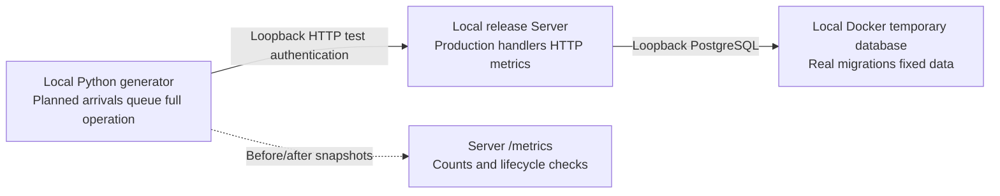

# Clumsies HTTP Local Load Test Report

This report serves Server maintainers and performance reviewers. It records completion under a fixed project-metadata workload, checks consistency between client observations and HTTP instrumentation, and establishes a reproducible regression baseline. Metric contracts are in the [observability design](/performance/observability-plan).

## Results

Six independent runs scheduled and successfully completed **24,400 business operations and 27,450 HTTP requests**. Every response was HTTP 200 and passed content validation. Business failures, transport errors, queue expiry and execution deadlines were all zero; temporary containers were cleaned up. The highest offered load was 500 business operations/s, corresponding to 625 scheduled HTTP requests/s for the read-write mix.

Acceptance establishes completion during the 20-second schedule plus drain in the specified local environment, with matching response and lifecycle counts. Assessment scope and further measurements appear at the end of this report.

## Environment

| Item | Condition |
| --- | --- |
| Date/time | 13 October 2026, 11:40–11:45 Beijing time; per-run starts retained in raw results |
| Host | Mac mini, Apple M4, 10 cores, 16 GiB, macOS 26.5.1; generator and Server on the same host |
| Docker | Local OrbStack Docker 29.8.2, 10 vCPU and approximately 7.82 GiB VM memory; these are VM resources, with container limits considered separately |
| Database | PostgreSQL 16.15, aarch64; a fresh temporary database and anonymous volume per run |
| Server | Rust release production Router, 4 Tokio workers, pool maximum 10, acquisition timeout 5 seconds |
| Fixed data | One Owner, 64 projects, one member/project, 256-byte description; updates preserve project count |
| Arrival schedule | Open-loop at 10/100/500 business operations/s for 20 seconds/run; 16 client workers |
| Operation budget | 5 seconds from planned arrival, including client queueing; no automatic retry |
| Outside the window | Build, migrations, authentication/data setup, two metrics snapshots and cleanup |
| Background activity | Other builds/tests for this task stopped; the development host and existing development containers remained active, so the environment was not exclusive |



## Workload and statistical method

Read runs cycle through the first project-list page of 50, project detail and project members. Read-write runs contain three reads and one description update per four operations. An update GETs the revision, PATCHes a 256-byte description with If-Match and checks the incremented revision. Its two HTTP exchanges form one business operation. Business operations/s and HTTP requests/s are counted separately; the client lock for same-project writes contributes to queueing.

The generator schedules arrivals independently of earlier completions. Every planned event remains in the denominator, including events whose budget expires before transmission; actual start, queue and terminal state are recorded separately. Success requires completion within budget, the expected HTTP status and valid fixed-data content. All planned operations in these runs actually started and succeeded, so successful latency and all-planned latency have identical distributions. Retaining planned arrivals under delay addresses coordinated omission; worker and same-host resource limits still bound the load the generator can test.

| Statistic | Boundary |
| --- | --- |
| Full operation latency | Planned arrival to terminal state, including client scheduling, project lock, queue, HTTP exchanges and decoding |
| Client queue | Planned arrival to the first actual HTTP start |
| Transport | Actual start to terminal state; an update includes two requests |
| Percentiles | Nearest-rank over raw operation samples, in ms; each load point measured once, including first connections and startup within the window |
| Successful operations/s | Success count divided by first planned arrival to last terminal state, including drain |
| Offered operations/s | Planned count divided by the 20-second schedule |

Client percentiles use raw samples; Server histograms use bucket estimates. Distinct boundaries and sample percentiles retain their own interpretations.

## Measurements

| Profile | Offered operations/s | Planned/successful operations | HTTP responses | Successful operations/s (with drain) | p50 ms | p95 ms | p99 ms |
| --- | ---: | ---: | ---: | ---: | ---: | ---: | ---: |
| Read | 10 | 200 | 200 | 10.05 | 9.11 | 11.89 | 13.36 |
| Read | 100 | 2,000 | 2,000 | 100.01 | 6.03 | 8.58 | 18.03 |
| Read | 500 | 10,000 | 10,000 | 499.87 | 1.71 | 2.69 | 3.67 |
| Read-write | 10 | 200 | 250 | 10.04 | 10.29 | 26.97 | 28.73 |
| Read-write | 100 | 2,000 | 2,500 | 99.94 | 5.48 | 18.55 | 25.40 |
| Read-write | 500 | 10,000 | 12,500 | 499.69 | 1.68 | 23.00 | 115.90 |

All failure categories were zero. Read 500/s and read-write 500/s each started 9,999 operations within the schedule and the final operation afterward; all remained included and completed. Maximum drain was approximately 12.60 ms. Low-rate runs schedule the last arrival before second 20, so throughput ending at the last terminal state can slightly exceed the offered rate.

| Profile and rate | Client queue p95 ms | Client queue p99 ms | Transport p95 ms | Transport p99 ms |
| --- | ---: | ---: | ---: | ---: |
| Read 10/s | 5.19 | 5.23 | 7.74 | 9.12 |
| Read 100/s | 2.37 | 2.54 | 6.62 | 15.70 |
| Read 500/s | 0.52 | 0.56 | 2.27 | 3.25 |
| Read-write 10/s | 5.20 | 5.25 | 22.02 | 25.88 |
| Read-write 100/s | 2.44 | 2.60 | 16.67 | 23.75 |
| Read-write 500/s | 0.64 | 78.29 | 12.26 | 72.74 |

## Instrumentation acceptance

For every run, response-counter, started-counter, response-termination-counter and histogram-count deltas in the API request scope matched client HTTP responses: 200, 2,000, 10,000, 250, 2,500 and 12,500 respectively. Cancelled/aborted deltas were zero and API in-flight in that scope returned to zero after drain. Health and metrics requests were outside the request check.

This checks the normal path through real TCP, authentication, database and production handlers. Isolated behavior tests separately cover cancellation, 5xx, unusual status codes, missing targets and SQL failure; failure coverage under load is described below.

## Reproduction and evidence

The tools are `dev/load-http.py` and the default-ignored `crates/server/tests/observability_load.rs`. They require Rust, Python 3 and a local Docker Unix socket. The driver connects only to loopback fixtures it creates and cleans up; the output path must not already exist.

```sh
python3 dev/load-http.py --self-check
python3 dev/load-http.py --profile read --rate 10 --duration 20 --workers 16 --deadline 5 --output /private/tmp/clumsies-load-read-10.json
python3 dev/load-http.py --profile read-write --rate 10 --duration 20 --workers 16 --deadline 5 --output /private/tmp/clumsies-load-write-10.json
```

Repeat sequentially with rates 100 and 500 and distinct output paths. The tool builds release code automatically and creates fresh data/cleanup for each run. Record changed hardware, request mix, data, workers or budget as new test conditions.

The measured package version was 0.20.7, with source baseline `6266c8a289f33f8624f7e213194b4b45518508ef`; the source fingerprint identifies the HTTP instrumentation changes in the measured checkout. Raw results include the algorithm and per-file hashes covering Cargo manifests/lock, Server src/migrations, test common and fixture/driver. The manifests matched before and after compilation.

| Evidence | SHA256 |
| --- | --- |
| Measured source set | `e46bec5b9971ab8e814b9a6151b169ab0036de3efb99b6624da81be71cfd429f` |
| Executed binary | `dd0f396fc7f2dd7198be632fcb3d5ee5029ed7f968db8c19eebb1cc47e73cadc` |
| Compressed raw results | `547e354d657dbffa75dcb28f060c33a099f0651f9134262d4dc3534a4603e64f` |

[Download all six raw results (JSON gzip)](/reports/observability-http-load.json.gz). The file contains all events, operation categories, actual times, before/after Server metrics, environment and cleanup status. Authentication tokens and real production data were excluded. Recalculation retains all planned events and the original denominator.

## Analysis, applicability and further measurements

At read-write 500/s, full-operation p99 was 115.90 ms, queue p99 78.29 ms and transport p99 72.74 ms. Tails appeared in both queueing and execution observations, while the three percentiles refer to different samples. Cause attribution requires same-event stage records and continuous resource, transaction and connection-acquisition evidence; generator, host, database and Server remain candidates.

Read latency and queueing were lower in higher-rate runs. Single short windows, same-host scheduling, cache and hardware state qualify comparisons across runs. These points preserve observed behavior; a causal relationship between increasing load and performance requires separate verification.

| Assessment | Coverage and additional requirements |
| --- | --- |
| Local regression | Normal-path baseline with fixed environment, data and mix; suitable for count and timing-boundary checks |
| Review acquisition | This workload did not exercise review_create/review_merge; those series have no samples |
| Failure under load | All operations succeeded; isolated tests verify failure handling, while recovery under load needs dedicated scenarios |
| Entrance and client | Caddy, TLS, Alloy/Loki ingestion, daemon, models, Draft/Review publication and blob transfer are outside this workload |
| Service objectives | Sustained capacity ceiling, production VPS capacity, long-term SLO and five-minute write freshness require their corresponding measurements |
| Capacity decisions | Use an independent environment close to production resources, disk and network; separate the generator, define representative data/mix, add steady, peak and sustained load, and record resources, dependencies, waits and business correctness |

Production pool changes, alert thresholds and maximum-throughput commitments require evidence under the corresponding production conditions. To explain the current read-write tail, locate queue and execution stages for the same event before selecting additional timings and retests.
