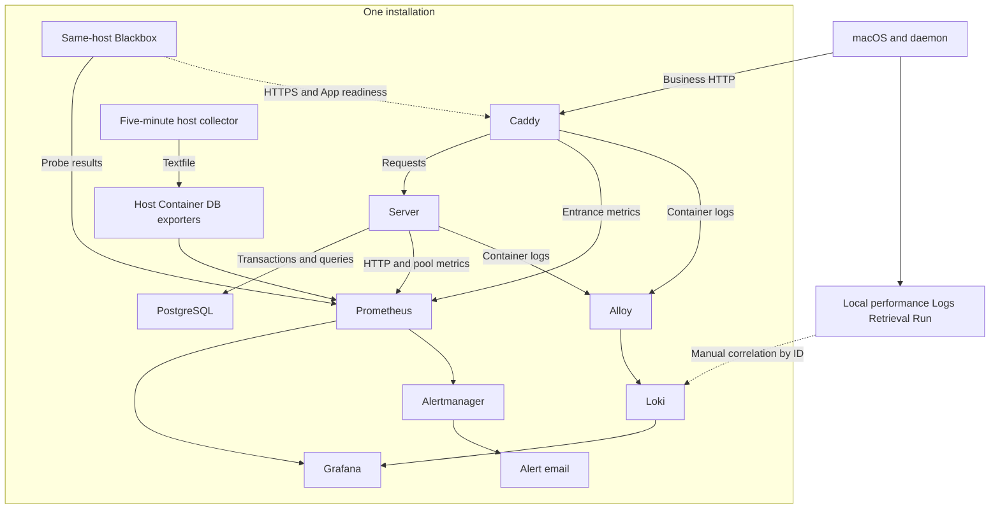

# Clumsies Observability Design

This design defines the metrics, logs, local diagnostics, dashboards and alerts for one Clumsies installation. It serves developers, installation operators and performance reviewers. Use the [operations runbook](/performance/observability-runbook) for incident procedures and the [local HTTP load report](/performance/observability-load-report) for measurement evidence.

## Purpose and scope

Observability supports four decisions: how quickly work enters and completes, how long completion takes, which failures affect users, and where resources or execution stages begin to wait. The [Google SRE signals](https://sre.google/sre-book/monitoring-distributed-systems/) organize this evidence as throughput, latency, errors and saturation. Overview establishes impact; detailed views identify sites or operations; correlated events and stage timings test the cause.

| Scope | Observed objects | Decision supported |
| --- | --- | --- |
| Central performance | Caddy, Server handlers, pool, PostgreSQL, host and containers | Request performance and dependency/resource state within the installation |
| Operations | Collection, logs, notifications, backups, restore, certificates and release records | Evidence confidence and recovery readiness |
| Local performance | macOS requests, daemon sync, Commit installation, indexing, retrieval and models | Completion and stage timings on one client |
| Product activity | Retained records, lifecycle states, conflicts and unread receipts | Product state and changes in retained records |

Throughput is completed work per unit time. Capacity is the load that sustains latency and error objectives on specified hardware, data and request mixes; evaluating capacity requires a separate load test.

## Collection architecture

| Data | Collection and retention | Use |
| --- | --- | --- |
| Central requests and resources | Default 30-second scrape; 90-day retention; rolling five-minute request charts | Compare performance and resources in the same window |
| Database and operational snapshots | Host collector every five minutes | Product records, active queries, task results and success times |
| Container logs | Alloy to Loki; 14-day retention | Individual requests and entrance/backend correlation |
| Local performance | Observations accumulated until process exit | Starts, current concurrency and outcome-specific distributions |
| Retrieval Run | Existing local recording and cleanup rules | Retrieval process and quality evidence |

An installation SSH tunnel provides access to central services. Local summaries and Retrieval Runs remain on the client; IDs connect the evidence manually. Current correlation uses request IDs. Full distributed tracing requires a separate trace-context contract.

Prometheus labels are bounded component, operation, method, route template, result and stage values. Loki stream labels are Compose project, service and container. Request, Run and business object IDs and original paths remain log fields; versions use dedicated information metrics/logs; queries, payloads and credentials follow the existing redaction rules. See [Prometheus label guidance](https://prometheus.io/docs/practices/naming/).

## Metric contracts

### Throughput and lifecycle

Entrance requests, Server handlers, logical client operations, sync attempts, index builds and retrieval calls have separate counts. Correlation IDs relate these layers; requests and retries keep their own counting boundaries.

| Metric | Dimensions | Count or snapshot boundary |
| --- | --- | --- |
| `caddy_http_request_duration_seconds_count` | host, code; `handler="subroute"` | Requests completed by one site-handling layer |
| `clumsies_http_requests_total` | route, method, status | Handler returns a Response; actual codes 100–599, otherwise `other` |
| `clumsies_http_business_requests_started_total` | route, method | Entry into business middleware |
| `clumsies_http_business_requests_terminated_total` | route, method, outcome | Handler ends as `response` or `cancelled_or_aborted` |
| `clumsies_http_business_requests_in_flight` | route, method | Business handlers executing at scrape time |
| `clumsies_db_pool_acquires_total` | operation, outcome | `review_create`/`review_merge` attempts; acquired, timeout, error, cancelled_or_aborted |

Business metrics exclude `/metrics` and `/api/v1/admin/health`, retaining unmatched requests. Caddy entrance metrics include synthetic probes and exclude automatic HTTP-to-HTTPS redirects. Daily Server queries require the current method label. Apply rate/increase to original counter series before aggregation to preserve restart detection. Increase extrapolates over a window and may be fractional.

Database and product activity use gauges. Last-hour counts include retained rows with `now()-60min ≤ created_at ≤ now()`; deletion reduces the count. Open Draft net change is a six-hour fitted inventory slope, displayed as Drafts/hour.

### Latency and results

| Object | Start and end | Classification and coverage |
| --- | --- | --- |
| Caddy entrance | Entrance handling to completion of the site layer | host, code; overview p50/p95 and detailed p99 |
| Server handler | Middleware entry to returned Response | route, method, status_class; body transfer follows this boundary |
| Connection acquisition | `pool.acquire` start to connection, error or interruption | Review creation/merge; includes waiting, validation and opening a connection; BEGIN and transaction execution are separate |
| Client HTTP | Call start to complete response and decoding | Local observation |
| Client operation | Operation start to its defined available result | Separate local save, Server ACK, Ref installation and searchability |
| Daemon activate | Parameter validation to daemon return | Includes query and history acknowledgment wait; accepted persistence may continue in the background; XPC transfer/client decoding are separate |
| Background work | Attempt start to result; original pending time to convergence | Attempt count and backlog age are retained separately |

HTTP histograms use route, method and status_class throughout. Success is 2xx/3xx; detailed error views use 4xx/5xx/other. Each distribution is accompanied by a sample count in the same scope. Rolling five-minute quantiles apply rate, aggregate by le and business dimensions, then histogram_quantile. Aggregate histogram buckets across instances before calculating quantiles. Server finite bounds are 5, 10, 25, 50, 100, 250, 500 milliseconds and 1, 2.5, 5, 10, 30 seconds; tails above the finite bounds remain subject to histogram estimation. See [histogram semantics](https://prometheus.io/docs/practices/histograms/).

Operations use a monotonic duration clock; durable pending times use UTC. Same-event timers retain their own boundaries across machines. Cross-layer diagnosis compares records from the same request. The runbook defines the relationships between overlapping stages and different timing boundaries.

### Errors and saturation

Preserve 5xx, dependency timeouts, transport failures and cancellation separately. Interpret 401, 403, 404, 409 and 429 against the operation contract; model preparation, intentional cancellation, expected conflicts and empty retrieval results have their own categories. An error ratio uses the same request scope and window for numerator and denominator, with the failure count alongside it.

| Object | Evidence read together | Scope |
| --- | --- | --- |
| Server pool | used, idle, open, max; acquire duration, result and concurrency | Pool gauges are concurrent snapshots; acquire covers review creation and merge |
| PostgreSQL | pg_up, connection count/limit, active queries, locks and transactions | Host SQL excludes the collector and idle transactions |
| CPU | Host percentage and container cores | 0.5 CPU seconds/second means 0.5 core |
| Memory | Available memory, working set, configured limits, OOM and swap | The 2 GiB reminder is an absolute working-set threshold |
| Disk | Root and persistent-data mount space, I/O | Inspect storage capacity and I/O latency separately |
| Local models/index | Execution, waits, workers and unresolved work | Local stage evidence |

### Local diagnostics

`Health.performance` aggregates fixed operation names into started, in_flight and per-result count, total_us and cumulative buckets. bucket_upper_bounds_ms defines finite bounds; count is the +Inf bucket. process_id, collection_started_at, snapshot_at and monotonic collection_elapsed_ms identify the process and collection interval. Process restart resets the counters.

For an interval, take two snapshots with the same process_id and collection_started_at. Subtract counts, duration sums and cumulative buckets, using the collection_elapsed_ms difference for rates; read in_flight from the current snapshot. Restart the sampling interval after a restart or counter regression. Local diagnostics export performance.json when available and record unavailability otherwise; the file remains on the client.

| Work | Local evidence |
| --- | --- |
| Sync cycle | converged, partial, failed, skipped; sync-lock wait and execution separately |
| Draft | Attempts, Server ACK and local synced commit; oldest_pending_operation_at covers accessible queued/syncing/retrying work, oldest_failed_operation_at covers failed work; both use original enqueue time |
| Commit | Project-scoped commit_sync.last_checked_success_at advances on trusted checks, including no change; Ref installation is separate. Unscoped status and Draft checked fields are None |
| Index | Build, publication, superseded and maintenance; pending_since survives target changes/retries and clears on convergence; published_at advances after atomic publication |
| Retrieval | Activate return time, Run, lock wait, model gate, blocking queue, execution and history persistence; Run.total_us runs from the post-validation start to query completion, with history measured separately |

Retrieval establishes a shared 60-second deadline after parameter validation; query and normal history acknowledgment wait use the remaining budget. A background writer owns accepted recording work and holds the history lock from acquisition through actual completion. When acknowledgment waiting expires, the call can return while persistence continues; the Run may remain running until commit. Persistence failures are recorded separately, so the technical response and historical terminal state are checked independently. history_lock_wait and history_persistence observe actual background stages; activate observes call return. Initial Run creation, timeout terminalization and failure recording retain their own waits; use activate snapshots for complete daemon time.

Index pending_since marks the first unresolved target after convergence, survives retries/target changes and clears when the current target converges. New backlog retains earlier published_at. Model-gate waits, blocking queue and actual execution have separate boundaries; a cancelled caller may leave blocking work executing, with resource ownership retained through its completion. See [local runtime](/runtime) and [retrieval/evaluation](/retrieval-evaluation) for local data contracts.

## Evidence confidence

| State | Evaluation and display |
| --- | --- |
| Active | Reachable source, valid fields/time; show throughput, distributions and samples |
| Idle | Trusted source without events; zero throughput and no latency samples |
| Failed | Scrape, SQL or task failure; retain attempt result and last successful record |
| Missing | Expected target or required field absent; unknown |
| Stale | Host/database age exceeds 900 seconds; current snapshot/task interpretation is unknown |
| Invalid time | Past-event time is later than the observer clock; show -2 and retain raw time |
| Unexecuted/uncovered | A stage has no observation; show the corresponding state |
| Unknown age | Durable work lacks a trustworthy start; retain unknown |

`clumsies_observability_expected_target` is derived from discovery catalogs. target_health reports 1/up, 0/failed scrape, -1/missing for each expected job/instance. A usable database snapshot requires SQL success=1 and both host/database ages within `0 ≤ age ≤ 900 seconds`. Snapshot status is -1/stale or missing, 0/failed, 1/valid and -2/invalid future time. Currentness requires nonnegative age.

SQL failure removes database samples. Actual textfile collection time determines freshness. Backup, restore and release success times remain neutral historical facts, separate from current confidence. A new trusted success can repair a future cache; a still-future receipt/archive remains invalid. Task states are success, failed, never, missing and running. A known startup failure may lack an exit time; a present future exit is invalid. Certificate expiry is a future deadline and uses remaining validity.

## Dashboards and navigation

Four dashboards provide impact, entrance, API and operational views. English and Chinese use the same queries. See [Grafana dashboard practices](https://grafana.com/docs/grafana/latest/visualizations/dashboards/build-dashboards/best-practices/).

| Dashboard | Content | Navigation |
| --- | --- | --- |
| Overview | Alerts/confidence; business throughput, samples, success latency; 5xx, concurrency/pool; four-site entrance signals | Site to entrance, business to API, collection/resources to Infrastructure |
| Entrance and Websites | Site filter, requests/s, response codes, latency/samples, slow requests and access logs | Request correlation to API A7 |
| Business API | Route/method, throughput/classified latency, busy/slow routes, lifecycle and correlation; collapsed product activity | App entrance to W5; dependencies to Infrastructure |
| Infrastructure and Operations | Expected targets, snapshots, database, resources, backup/restore, certificates, logs, notifications, Server version and release | Prometheus, Alertmanager and the runbook |

Cross-page links preserve time and applicable site, route, method and request_id. API A7 is the shared Caddy/Server correlation view and the only manual request-ID input, matching the complete ID across both layers. Dashboard navigation changes views; panels present measurements.

Local server_request_id directly identifies entrance/Server records. client_request_id identifies Server records first; their internal request_id locates the entrance. One client identity can span attempts. retrieval_run_started links request_id to run_id. Eight product gauges remain in the collapsed API section with snapshot state/age.

## Service objectives and alerts

The installation retains its [deployment objectives](/guides/deploy-for-an-org#service-objectives). Collection correctness, operations and objective compliance have separate acceptance criteria.

| Objective | Target | Measurement requirements |
| --- | --- | --- |
| Public availability | 99.5% over 30 days | App HTTP 200 and JSON status=ok; HTTPS module for static sites; report probe coverage/missing events |
| Write freshness | 99% of eligible changes reach Server within 5 minutes | First durable enqueue through verified corresponding persistent Server ACK; full SLI remains to implement |
| Durability | RPO ≤ 26 hours; RTO ≤ 1 hour | Restorable copy/backup age; independent elapsed time from recovery start to available service |
| App entrance latency | p95 < 1 second | Caddy App entrance; request scope/objective window remain to define |
| Server errors | < 1% | Per-site 5xx in the same entrance request population; API route/method localizes causes |

The write SLI assigns events to the first-enqueue window. Eligible logical operations reaching the 300-second decision point form the denominator; verified ACKs within 300 seconds form the numerator. Unexpired pending work and window lag are reported separately. Retries retain the same operation, and late success retains its original decision. Eligibility defines merged, cancelled and local-only work in advance. Client reception is a verifiable upper bound on confirmation time.

Alerts cover actionable faults, capacity risks and collection-chain failures. At low traffic, read counts, ratios and operation impact together. Product inventories describe work state.

| Rule group | Condition and duration | Investigation |
| --- | --- | --- |
| Availability | Probe failure for 2 minutes; scrape failure/missing target for 5 minutes; certificate below 14 days for 1 hour | Site, target, certificate |
| Entrance errors | Per-site rolling five-minute 5xx >1% for 5 minutes | Entrance logs/API |
| Capacity | Filesystem available <15%, host available memory <10%, PostgreSQL connections >80%, each for 10 minutes | Resources/database |
| Fixed memory reminder | Container working set >2 GiB for 10 minutes | Container trend/actual limit |
| Database | pg_up=0 for 2 minutes; active query >60 seconds in valid snapshots for 5 minutes | Database, locks/transactions |
| Collection | Missing/failed/stale/invalid host/database snapshot for 5 minutes | Service/timer, textfile, SQL |
| Time validity | OperationalTimestampInvalid: reachable node with a host/DB/backup/restore/release/unit-exit timestamp >Prometheus time for 5 minutes, warning | Clock/original record |
| Logs/notification | Send retries for 5 minutes; drops or notification failure within 5 minutes | Alloy/Loki/Alertmanager |
| Backup/restore | Backup missing/invalid/older than 26 hours for 30 minutes; drill missing/invalid/older than 8 days for 1 hour; failed/unavailable task for 5 minutes | Service/timer, result, success record |

Normal email waits 30 seconds initially, groups changes every 5 minutes, repeats persistent faults every 4 hours and sends recovery. Warning/critical share a receiver. Watchdog remains firing, waits 10 seconds initially and repeats every 24 hours; an actual inbox receipt verifies delivery. Notifications identify the affected object, window, result/sample, detail link and first action.

## Acceptance and remaining measurement work

| Scope | Acceptance |
| --- | --- |
| Views/navigation | Eight equivalent EN/ZH dashboards, mapped original metrics, preserved time/filters |
| HTTP classes | Method isolation, separate outcome distributions/samples, 504/599 classified 5xx |
| Lifecycle | Matching started/response/cancelled/in-flight scopes; balanced cancellation |
| Acquisition | Isolated review-create/merge scope with acquisition, timeout, failure, interruption and concurrency |
| Confidence | Stopped timer, SQL failure, missing target, future time and cache recovery visible |
| Operations | Distinct never/failed/missing/running; latest failure coexists with last success |
| Request evidence | Entrance/handler/body boundaries, exact IDs and effective redaction |
| Local diagnostics | Process intervals, sync ACK/local commit, index publication, activate return/background persistence and stage execution states |

Configuration/behavior checks use `deploy/observability/test.py`, `test-delivery.py`, Server metrics/telemetry and local behavior tests. Failure injection/load tests run in isolation; production acceptance uses real traffic and readiness checks. Field or completion changes update queries, rules and fixtures together.

Remaining work includes write eligibility, durable first-ACK deduplication and expired unfinished denominators; latency/error objective windows and populations; operation response budgets; independent RTO timing; external host-loss observation and alert ownership/channels. Same-host monitoring covers installation components/probes; host loss and failure of the notification channel require an external observer.

Statistical interpretation pairs low-sample p99 with its count; idle windows have no latency. Entrance, handler, client and overlapping stages retain separate timing boundaries. Five-minute SQL snapshots describe the sampled state; product row counts describe retained activity. Retrieval quality uses human evaluation, while capacity reports include hardware, data, request mix and duration.

## Appendix A: Historical data and upgrades

Daily dashboards use the current route/method/status_class HTTP schema. Historical route-only histograms contain mixed results and remain in Prometheus for queries under their original labels. Historical global in-flight includes health/metrics; current business views use business in-flight. Allow a complete five-minute window after upgrade before reading classified latency.

An older daemon without performance or a durable backlog start returns unavailable/unknown age. Client decoding remains compatible. Existing delivery/rollback manages upgrades, preserving success records and historical observations under their original contracts. Five-minute release snapshots identify the latest recorded success; historical revision mapping uses release records.

## Appendix B: Original 40-panel destinations

O is original Overview, A Business API, W Website Traffic, I Infrastructure and P the collapsed API product section. Existing three UIDs remain; update bookmarks after cross-dashboard moves. Dashboard navigation replaces help-only panels.

| Source | Original panel | Current destination |
| --- | --- | --- |
| O1 | Site availability | O1, per site |
| O2 | Entrance requests/s | O2 → W |
| O3 | Site 5xx | O3, matching samples |
| O4 | Entrance p95 | O4 → W |
| O5 | Backup age | I16, success age/time |
| O6 | Certificate days | I19, per certificate |
| O7 | Root free space | I14, persistent mounts |
| O8 | Host CPU | I10, percentage |
| O9 | Host memory | I11, availability/pressure |
| O10 | Container CPU | I12, cores |
| O11 | Container memory | I13, working set/limits |
| O12 | PostgreSQL connections | I5, count/limit |
| O13 | Longest query | I9, valid snapshot |
| O14 | Scrape targets | I1, expected status; Overview summary |
| O15 | Log retries/drops | I20 |
| O16 | Loki entries/s | I21, source/transport state |
| A1 | Handler latency | A1, success classes; separate errors |
| A2 | Observed requests | A2, total/classified samples |
| A3 | Requests/s by status | A3 |
| A4 | Requests >1s | A4, investigation filter |
| A5 | Slow backend | A5, route/method/ID |
| A6 | Slow App entrance | API App entrance navigation → W5 |
| A7 | Correlated request | A7, shared correlation |
| A8 | Server pool | I4, scoped acquire timing |
| A9 | Busy routes | A9, route/method details |
| A10 | Last-hour Commits | P / A10, retained-row gauge |
| A11 | Last-hour Drafts | P / A11 |
| A12 | Last-hour Reviews | P / A12 |
| A13 | Draft lifecycle | P / A13 |
| A14 | Open Draft net change | P / A14, six-hour fit |
| A15 | Valid conflicting Drafts | P / A15, candidate validity |
| A16 | Stored unread receipts | P / A16, including archived/inaccessible |
| A17 | Oldest open Draft creation age | P / A17, zero without open Drafts |
| W1 | Entrance latency | W1, p50/p95/p99 and count |
| W2 | Observed requests | W2, window extrapolation |
| W3 | Requests/s by status | W3 |
| W4 | Requests >1s | W4 |
| W5 | Slow site requests | W5, path/bytes/upstream timing |
| W6 | Access logs | W6 |
| W7 | Correlated request | Website Request correlation navigation → A7 |
