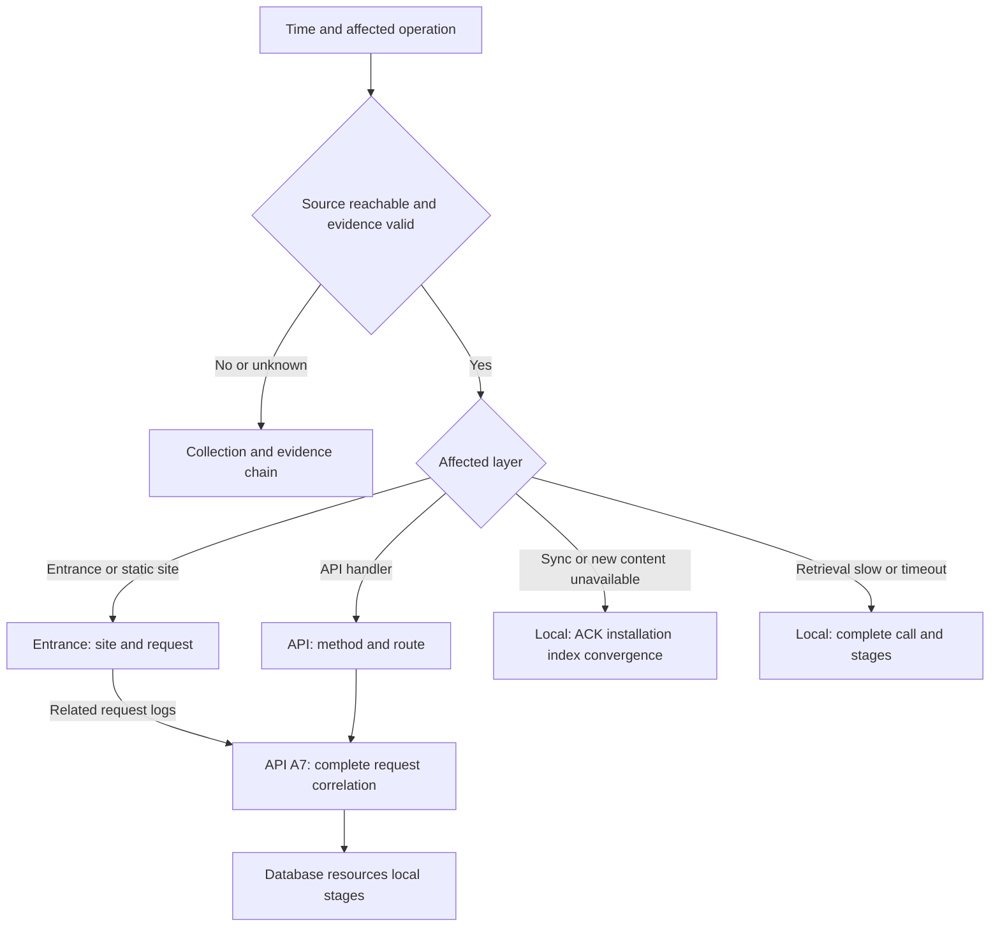

# Clumsies Observability Operations Runbook

This runbook serves developers and operators investigating performance, synchronization and retrieval incidents. Confirm evidence confidence, compare throughput, latency, errors and waits in one time window, then verify a cause with a specific request or task. Metric definitions and alert thresholds are in the [observability design](/performance/observability-plan).

## Access and incident context

Central investigation requires Grafana read access; host service logs require the corresponding SSH and system permissions. Client incidents use that client's local diagnostics. Open an SSH tunnel to the installation's monitoring services:

```sh
ssh -N -L 3000:127.0.0.1:3000 -L 9090:127.0.0.1:9090 -L 9093:127.0.0.1:9093 <installation-host>
```

| Page | Tunnel address | Purpose |
| --- | --- | --- |
| Overview | `http://localhost:3000/d/clumsies-overview/view` | Impact, performance and source status |
| Business API | `http://localhost:3000/d/clumsies-api/view` | Method/route diagnosis and complete request-ID correlation |
| Entrance and Websites | `http://localhost:3000/d/clumsies-web/view` | Site entrance and access logs |
| Infrastructure and Operations | `http://localhost:3000/d/clumsies-infrastructure/view` | Database, resources, collection and recovery evidence |
| Prometheus Alerts | `http://localhost:9090/alerts` | Rules, pending/firing and duration |
| Alertmanager Alerts | `http://localhost:9093/#/alerts` | Notification groups and silences |

Record the absolute incident time, affected operation or site, client and Server versions, and available request or operation IDs. Use the same absolute time range on every page. Overview source status establishes whether charts support a current assessment; Infrastructure records the actual Server version and release information.

## Investigation paths



### Read charts in order

1. Confirm source status, current faults, business requests/s, sample counts, 5xx and successful handler latency in Overview.
2. Select the corresponding site or method/route and compare the same operation. A changed request mix changes aggregate percentiles.
3. Compare starts, responses, cancellations and in-flight work to distinguish completion, waiting and fast failure.
4. Inspect acquisition, database, CPU, memory and disk evidence in the same window, then test a cause with a representative request or task.
5. Retest the same operation and representative load after repair. Verify correct results, restored waits/errors and improved user completion time.

| Signal pattern | First hypothesis to test | Evidence needed |
| --- | --- | --- |
| Throughput rises; latency and errors remain stable | Completion under the current load | Sustained trends; a separate load test evaluates capacity |
| Completed throughput flattens; concurrency or waits rise | Dependency or execution limit | Acquire, transactions, model/workers and resources |
| High error ratio at low traffic | Impact of a few failures | Failure count, operation importance and individual requests |
| Latency falls; errors rise | Fast failure | Success/error distributions and response codes |
| Slow entrance; fast handler | Proxy, body transfer or differing samples | Same-ID entrance, upstream and client records |
| No traffic and no latency samples | Idle source or requests not arriving | Scrapes, probes and starts |
| Snapshot unchanged; age grows | Frozen collection | Timer, SQL result and actual textfile collection time |

### Statistical reading

`rate` measures events per second; `increase` extrapolates over a window and can be fractional. HTTP percentiles are rolling five-minute bucket estimates classified by method and outcome. Read the matching sample count, especially for a low-sample p99. Idle windows retain no latency sample.

Local `Health.performance` is process-cumulative. An interval needs two snapshots with the same process_id and collection_started_at: subtract counts, duration sums and cumulative buckets; use the collection_elapsed_ms difference for rates. Read current in_flight directly. Start a new interval after process restart or counter regression.

## Slow API or review operations

### Locate

1. Confirm business completion throughput, 5xx count/ratio, successful handler latency and samples in Overview.
2. Select the actual method and route template in Business API. Inspect busy routes, slow requests and error-response distributions.
3. Expand a representative log and follow **Related request logs**, carrying its real ID and time to API A7. Manual correlation also uses the complete ID in the API **Request ID** field; website navigation leads to that shared view.
4. Match Caddy and Server using the entrance response ID or server_request_id from local HTTP records. With only a client ID, find Server client_request_id first, then use that record's internal request_id for the entrance. Correlation spans site/route/method.
5. Inspect pool used/idle/open/max, database reachability and connection capacity in Infrastructure. Review creation and merge also expose their acquisition durations, results and in-flight attempts.
6. For slow entrance handling, follow the API App entrance link to website W5 for original path, response size and upstream timings. Compare with the client's complete HTTP/XPC duration.

### Assess and recover

Acquisition includes waiting, validation and opening connections. Inspect connection holding, transactions and locks before choosing a recovery or capacity change. A fast Server with a slow user operation calls for body-transfer, decoding, client scheduling and repeated serial-request evidence.

After client timeout or cancellation, confirm the original Server result before retrying through the existing idempotency or version mechanism.

### Acceptance

Evidence identifies the dominant stage in representative operations. Under equivalent conditions, waits, errors, throughput and full user completion time recover; business results and correlation identities remain correct.

## Changes not synchronized or searchable

### Locate

1. Check local save, durable Server ACK, local synced commit, Commit/Ref installation and current-index searchability separately.
2. In local Runtime diagnostics, use a stable operation ID to inspect enqueue, pending/failed/blocked, each attempt and Server confirmation. oldest_pending_operation_at covers accessible queued/syncing/retrying work; oldest_failed_operation_at covers failed work. Both preserve original enqueue time.
3. Select the project and inspect commit_sync.last_checked_success_at separately from Ref installation time. A trusted no-change check advances checked; an idle project's installation may be old. Checked is project-scoped; None in unscoped status and Draft channel means the field is outside that scope.
4. Compare observed remote Ref/cursor and locally installed values; record when the remote target was observed.
5. Inspect index target, active head, pending_since, published_at and recent build/publication results. pending_since survives retries and target changes and clears on convergence. published_at advances after actual atomic publication; a new backlog retains the earlier publication time.
6. Distinguish superseded work yielding to a new target, post-publication maintenance failure, permission blocking and actual index unavailability.

### Assess and recover

Verify the original logical operation's result and remaining work. Interpret converged, partial, failed and skipped sync cycles separately from individual attempt outcomes. Record permission blocking and inaccessible objects explicitly. Historical work without a trustworthy start retains unknown age.

Use existing operation recovery procedures. Human Drafts and unread inventory describe work state; cleanup and publication follow the business workflow.

### Acceptance

The original operation has a clear terminal state, the target Ref is installed, the current index matches the valid target and its content is searchable. Remaining work and blockers are explained.

## Slow retrieval or timeout

### Locate

1. Find local retrieval_run_started by request ID, then inspect the corresponding Run by run_id. Use Health.performance activate for the complete daemon call and compare it with complete client XPC time.
2. Hold input, corpus size and model cold/warm state constant; record concurrent index and embedding work.
3. Inspect search/storage/history lock waits, model-gate wait, blocking queue, model execution and background history persistence separately. Preserve unexecuted or uncovered stage states.
4. Respect timing boundaries: effective_memory and index_ensure may overlap; Run embedding/rerank include waits; Run.total_us spans the post-validation start to query completion. Activate includes validation, query and history acknowledgment wait, ending at daemon return. Query and normal acknowledgment wait share the deadline established 60 seconds after the post-validation start.
5. Check the historical task's actual terminal state. Accepted background persistence may continue after acknowledgment waiting expires or the caller leaves, with the Run remaining running until commit. Use history_lock_wait/history_persistence and Run status to verify completion or persistence errors. Initial Run creation, timeout terminalization and failure recording retain their own waits; observe the complete call through activate and client timing separately.

### Assess and recover

Rising waits with stable execution suggest contention or concurrency; slower execution with stable waits calls for model, hardware and workload checks. Logs and local resource tools supplement missing stage observations.

Evaluate technical success, empty results and retrieval quality separately. After restoring timeout behavior, use the existing human evaluation and retain the definitions of quality measures such as Recall/nDCG.

### Acceptance

Waiting, execution, background history persistence and technical failure are distinguishable. Calls return normally, historical tasks reach a clear terminal state, timing boundaries are explicit and unexecuted/failed samples retain their correct classification.

## Empty charts, frozen data or source faults

### Locate

1. Inspect each expected target in Infrastructure: healthy, scrape failure or missing. Catalogs are `prometheus/targets.json` and `prometheus/probes.json`.
2. Separate exporter reachability from internal task results; inspect pg_up, SQL success and the host timer.
3. Check actual host/database collection times. Current valid age is 0–900 seconds; -2 means an invalid future timestamp and -1 means stale/missing. Inspect clocks, rollback and source timestamps, preserving original records.
4. For logs, check time range, discovery, Alloy/Loki, retries and drops. Interpret zero sends against source activity.
5. For backup and restore, inspect latest task state, last-success age, original success time and collection state separately. Success, failed, never, missing and running are distinct; a new failure can coexist with historical success. Release time and confidence also have separate fields.
6. Inspect Alertmanager scrapes, failure counters, logs and silences for notification problems. Infrastructure navigation opens Prometheus and Alertmanager directly.

Run these read-only checks on the installation host:

```sh
cd /opt/clumsies/observability
sudo systemctl status clumsies-observability-metrics.timer --no-pager
sudo systemctl show clumsies-observability-metrics.service -p Result -p ExecMainExitTimestamp
sudo journalctl -u clumsies-observability-metrics.service --since "30 minutes ago" --no-pager
sudo docker compose --file compose.observability.yml --env-file .env logs --since 30m --tail 200 alloy loki alertmanager
```

Use credentials through the existing configuration and retain redacted evidence in incident records. Restore the source through the [deployment guide](/guides/deploy-for-an-org) and configuration delivery, then verify new events and actual collection times advance. A new valid success can repair a future cache; still-future source receipts or archives require investigation. Preserve original receipts and historical observations.

### Acceptance

Every source has a clear result and actual observation time. Missing, frozen and failed sources remain visible; after recovery new events reach dashboards/logs and alerts resolve with the underlying fault.

Watchdog remains firing as a notification heartbeat; an actual inbox receipt verifies email delivery. Other rules that are not firing have not met their trigger conditions. Warning and critical share a receiver.

## Interpretation boundaries and remaining work

| Evidence | Assessment scope |
| --- | --- |
| Central dashboards | Installation entrance, Server and dependencies; client waits use local diagnostics |
| Cross-layer timing | Same-event records; different percentiles and overlapping stages retain separate interpretations |
| Acquisition | review_create/review_merge acquisition; other transactions need their own evidence |
| SQL snapshots | Five-minute sampled state; short connection/query congestion can fall between samples |
| Request correlation | Exact complete JSON IDs; empty values return no logs, prefixes do not match, client identity may span attempts |
| Client synchronization | HTTP 2xx, Commit inventory and attempt success are checked separately from durable completion; the complete five-minute write SLI contract and durable denominator remain to implement |
| Local performance | Process interval and daemon return boundary; XPC transfer, client decoding and background history persistence observed separately |
| Retention | Logs 14 days, metrics 90 days; request evidence for historical anomalies depends on log retention |
| Fault detection | Same-host monitoring and one email channel; whole-host loss and channel failure need an external observer |

## Incident record

Record affected operation, absolute time range, environment/versions, correlation IDs, representative samples, dominant-stage evidence, cause hypotheses, repair and retest results. Capacity conclusions also record hardware, data size, request mix and duration. Preserve access and redaction boundaries when referencing local or request evidence.

See the [end-to-end latency model](/performance/latency-model), [local runtime](/runtime) and [HTTP local load report](/performance/observability-load-report) for related contracts and reproducible conditions.

## Appendix: Historical data and compatibility

Daily dashboards use current method/status_class and business in-flight. Historical route-only histograms contain mixed outcomes; global in-flight includes health/metrics. Interpret historical queries under their original boundaries. Allow a complete five-minute window after upgrade before reading classified percentiles.

An older daemon lacking performance or a durable backlog start retains unavailable or unknown age; clients decode through the compatibility contract.
