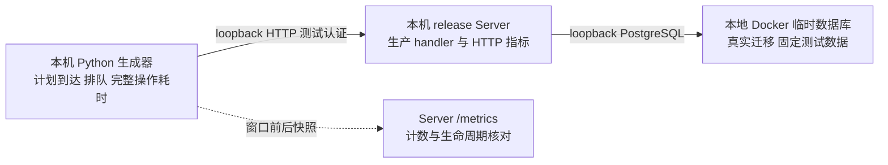

# Clumsies HTTP 本地负载测试报告

本报告面向 Server 维护者与性能评审人员，记录固定项目元数据负载的完成情况，验证客户端观察与 HTTP 埋点的一致性，并提供回归比较基线。指标口径见[可观测性设计方案](/zh/performance/observability-plan)。

## 结果摘要

六组独立测试共计划并成功完成 **24,400 次业务操作、27,450 次 HTTP 请求**。全部响应为 HTTP 200，内容检查通过；业务失败、传输错误、排队超时和执行超时均为零，临时容器清理完成。最高计划速率为每秒 500 次业务操作，读写组合对应每秒 625 次 HTTP 请求。

验收结果支持指定本地环境中，两类项目元数据负载在 20 秒计划窗口及收尾阶段完成，且请求生命周期与响应指标计数一致。适用范围和后续测量需求见报告末节。

## 测试环境

| 项目 | 条件 |
| --- | --- |
| 日期与时间 | 2026 年 10 月 13 日，北京时间 11:40–11:45；逐组开始时间保存在原始结果 |
| 宿主 | Mac mini，Apple M4，10 核，16 GiB，macOS 26.5.1；生成器与 Server 同机 |
| Docker | OrbStack 本地 Docker 29.8.2，10 vCPU、约 7.82 GiB 虚拟机内存；该值为虚拟机资源，单容器限制另计 |
| 数据库 | PostgreSQL 16.15，aarch64；每组新建临时数据库与匿名卷 |
| Server | Rust release 构建的生产应用 Router，4 个 Tokio worker，连接池上限 10，acquire timeout 5 秒 |
| 固定数据 | 一个 Owner、64 个项目、每项目一个成员、256 字节描述；更新保持项目数量 |
| 到达计划 | open-loop，10/100/500 次业务操作/秒，每组安排 20 秒；16 个客户端工作线程 |
| 操作预算 | 从计划到达起 5 秒，包含客户端排队；失败无自动重试 |
| 窗口外活动 | 构建、迁移、认证与数据初始化、两次 metrics 快照、清理 |
| 共存活动 | 本任务的其他构建与测试停止；开发机与既有开发容器仍运行，环境不独占 |



## 负载与统计方法

只读组循环执行项目列表第一页 50 条、项目详情、项目成员列表。读写组每四个操作包含三个读操作和一次描述更新；更新先 GET revision，再以 If-Match PATCH 256 字节描述，并检查 revision 增加。更新的两次 HTTP 往返算一个业务操作。业务操作/s 和 HTTP 请求/s 分别统计，同项目写入的客户端互斥等待计入排队。

生成器按预定时间独立安排到达，不等待上一操作完成。所有计划事件均进入分母，包括未发出便超过预算的事件；实际开始、排队与终态各自记录。成功要求预算内完成、HTTP 状态正确且内容满足固定数据约束。本次所有计划均实际开始并成功终止，成功耗时与全体计划耗时分布相同。这一计数规则保留延迟时的计划到达，控制 coordinated omission；生成器线程和同机资源仍限制可测试负载。

| 统计项 | 边界 |
| --- | --- |
| 完整操作耗时 | 计划到达至终态，含客户端调度、项目锁、排队、HTTP 往返和解码 |
| 客户端排队 | 计划到达至首次 HTTP 实际开始 |
| transport | 实际开始至终态；更新包含两次 HTTP 请求 |
| 分位数 | 原始操作样本 nearest-rank，单位 ms；每个负载点测一次，初次连接及启动段进入窗口 |
| 成功操作/s | 成功数除以首次计划至最后终态的时间，含收尾 |
| 计划操作/s | 计划数除以 20 秒安排时长 |

上述客户端分位数基于原始样本，Server histogram 基于桶估计。不同统计边界和不同分位数分别解释。

## 测量结果

| 组合 | 计划操作/s | 计划/成功操作 | HTTP 响应 | 成功操作/s（含收尾） | p50 ms | p95 ms | p99 ms |
| --- | ---: | ---: | ---: | ---: | ---: | ---: | ---: |
| 只读 | 10 | 200 | 200 | 10.05 | 9.11 | 11.89 | 13.36 |
| 只读 | 100 | 2,000 | 2,000 | 100.01 | 6.03 | 8.58 | 18.03 |
| 只读 | 500 | 10,000 | 10,000 | 499.87 | 1.71 | 2.69 | 3.67 |
| 读写 | 10 | 200 | 250 | 10.04 | 10.29 | 26.97 | 28.73 |
| 读写 | 100 | 2,000 | 2,500 | 99.94 | 5.48 | 18.55 | 25.40 |
| 读写 | 500 | 10,000 | 12,500 | 499.69 | 1.68 | 23.00 | 115.90 |

各失败类别均为零。只读 500/s 和读写 500/s 分别有 9,999 个操作在安排窗口内实际开始，最后一个在窗口后开始；全部保留并完成。最长收尾约 12.60 ms。低速组末次计划早于第 20 秒，因此按最后终态计算的吞吐可略高于计划速率。

| 组合与速率 | 客户端排队 p95 ms | 客户端排队 p99 ms | transport p95 ms | transport p99 ms |
| --- | ---: | ---: | ---: | ---: |
| 只读 10/s | 5.19 | 5.23 | 7.74 | 9.12 |
| 只读 100/s | 2.37 | 2.54 | 6.62 | 15.70 |
| 只读 500/s | 0.52 | 0.56 | 2.27 | 3.25 |
| 读写 10/s | 5.20 | 5.25 | 22.02 | 25.88 |
| 读写 100/s | 2.44 | 2.60 | 16.67 | 23.75 |
| 读写 500/s | 0.64 | 78.29 | 12.26 | 72.74 |

## 埋点一致性验收

每组前后的业务响应 counter、started counter、response 终止 counter 和 histogram count 增量，均等于客户端 HTTP 响应数，依次为 200、2,000、10,000、250、2,500、12,500。Cancelled/aborted 增量为零，收尾后业务 in-flight 为零。health 和 metrics 在业务核对范围之外。

本项通过真实 TCP、认证、数据库和生产 handler 验证正常路径的一致性。隔离行为测试另覆盖取消、5xx、异常状态码、目标缺失和 SQL 失败；负载测试的故障覆盖范围见下文。

## 复现与原始证据

工具为 `dev/load-http.py` 和默认忽略的 `crates/server/tests/observability_load.rs`，需要 Rust、Python 3 和本地 Docker Unix socket。工具只连接自己创建的 loopback fixture，并负责清理；输出路径需尚不存在。

```sh
python3 dev/load-http.py --self-check
python3 dev/load-http.py --profile read --rate 10 --duration 20 --workers 16 --deadline 5 --output /private/tmp/clumsies-load-read-10.json
python3 dev/load-http.py --profile read-write --rate 10 --duration 20 --workers 16 --deadline 5 --output /private/tmp/clumsies-load-write-10.json
```

依次用 100 和 500 替换速率并选择不同输出路径，逐组运行。工具自动 release 编译，每组重建数据并清理。更改硬件、请求组合、数据、线程或预算时，作为新的测试条件记录。

被测包版本为 0.20.7，源码基线为 `6266c8a289f33f8624f7e213194b4b45518508ef`，当次 HTTP 埋点改动由源码指纹确定。原始结果保留算法与逐文件哈希，覆盖 Cargo manifests/lock、Server src/migrations、测试 common、fixture/driver；实际编译前后清单一致。

| 证据标识 | SHA256 |
| --- | --- |
| 被测源码集合 | `e46bec5b9971ab8e814b9a6151b169ab0036de3efb99b6624da81be71cfd429f` |
| 实际执行二进制 | `dd0f396fc7f2dd7198be632fcb3d5ee5029ed7f968db8c19eebb1cc47e73cadc` |
| 压缩原始结果 | `547e354d657dbffa75dcb28f060c33a099f0651f9134262d4dc3534a4603e64f` |

[下载六组原始结果（JSON gzip）](/reports/observability-http-load.json.gz)。结果包含全部事件、操作分类、实际时间、窗口前后 Server 指标、环境和清理状态；认证 token 与真实生产数据均未进入报告。复核时保留所有计划事件及原始分母。

## 分析、适用范围与后续测量

读写 500/s 的完整操作 p99 为 115.90 ms，排队 p99 为 78.29 ms，transport p99 为 72.74 ms。尾部同时出现在排队和执行观察中，三个分位数各自对应不同样本。定位原因需要同一事件的阶段记录和连续资源、事务、连接获取证据，生成器、宿主、数据库及 Server 均在调查范围内。

只读高负载组的延迟更低，排队也较小。单次短窗口、同机调度、缓存与硬件状态是跨组比较的条件；这些数据用于保存各点表现，负载与性能之间的因果关系需另行验证。

| 评估用途 | 覆盖与补充要求 |
| --- | --- |
| 本地回归 | 固定环境、数据和请求组合的正常路径基线，可核对请求计数和测量边界 |
| Review acquire | 本组合未经过 review_create/review_merge，相关 series 无样本 |
| 故障压力行为 | 本次负载全部成功；故障处理通过隔离测试验证，压力下恢复行为需专门场景 |
| 入口与客户端 | Caddy、TLS、Alloy/Loki 写入、daemon、模型、Draft/Review 发布和 blob 传输均在本次负载范围之外 |
| 服务目标 | 持续容量上限、生产 VPS 容量、长期 SLO 和五分钟写入新鲜度尚需对应测量 |
| 容量决策 | 使用生产资源、磁盘和网络条件接近的独立环境；分离生成器，定义代表性数据与请求组合，增加稳定、峰值及持续负载，同时记录资源、依赖、等待和业务正确性 |

调整生产连接池、告警阈值或承诺最大吞吐，应使用对应生产条件下的容量和目标证据。解释当前读写尾部时，先定位同一事件的排队与执行，再选择补充计时与复测。
