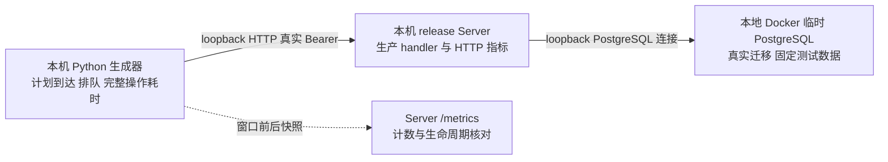

# Clumsies HTTP 本地负载测试报告

面向 Server 维护者和性能评审人员，记录项目元数据接口在固定负载下的表现，验证 HTTP 埋点与客户端观察是否一致，并建立可复现的本地基线。看板及指标定义见[可观测性设计方案](/zh/performance/observability-plan)。

## 结果与适用范围

六组独立测试共安排并成功完成 **24,400 次业务操作、27,450 次 HTTP 请求**。全部响应为 HTTP 200，内容检查通过；没有业务失败、传输错误、排队超时或执行超时，未遗留本次临时容器。最高测试速率为每秒 500 次业务操作，读写组合对应每秒 625 次计划 HTTP 请求。

这些结果支持“指定本地环境下，两类项目元数据负载在 20 秒窗口内完成，且新增请求指标计数一致”。测试没有找到持续容量上限，也未验证生产 VPS 容量、长期 SLO、公网入口或客户端同步新鲜度。

| 测试信息 | 条件 |
| --- | --- |
| 日期与时间 | 2026 年 10 月 13 日，北京时间 11:40–11:45；逐组开始时间保存在原始结果 |
| 宿主 | Mac mini，Apple M4，10 核，16 GiB，macOS 26.5.1；生成器与 Server 同机 |
| Docker 环境 | OrbStack 本地 Docker 29.8.2，10 vCPU、约 7.82 GiB 虚拟机内存；不代表单容器限制 |
| 数据库 | PostgreSQL 16.15，aarch64；每组新建临时数据库与匿名卷 |
| Server | Rust release 构建的生产应用 Router，4 个 Tokio worker，连接池上限 10，acquire timeout 5 秒 |
| 固定数据 | 一个 Owner、64 个项目、每项目一个成员、256 字节描述；写操作不新增项目 |
| 到达计划 | open-loop，10/100/500 次业务操作/秒，每组安排 20 秒；16 个客户端工作线程 |
| 操作预算 | 自计划到达起 5 秒，包含客户端排队；失败不自动重试 |
| 窗口外活动 | 构建、数据库迁移、初始化认证和数据、两次 metrics 快照、清理 |
| 共存活动 | 停止本任务的其它构建与测试；开发机和既有开发容器仍运行，环境不独占 |



## 请求组合与统计口径

只读组循环执行项目列表第一页 50 条、项目详情、项目成员列表。读写组每四个操作包含三个上述读操作和一次项目描述更新；更新先 GET 当前 revision，再带 If-Match PATCH 描述，确认 revision 增加。两次 HTTP 往返算一个更新业务操作，因此业务操作/s 与 HTTP 请求/s 分别报告。同一项目的写入在客户端互斥，等待纳入排队时间。

每次计划到达都保留事件，即使尚未发出便已超时也进入分母。成功要求在预算内完成、状态正确、响应内容符合固定数据约束。成功率以所有计划操作为分母；本次所有计划均实际开始并得到成功终态，故成功耗时与全体计划耗时分布一致。

完整操作耗时从**计划到达**量至完成，包括客户端调度、项目锁、排队、HTTP 往返与解码。客户端排队量至首次 HTTP 开始；transport 从实际开始量至终态，更新包含两次请求。它们均不是 Server handler 耗时，多个分位数不能相减得到另一阶段耗时。

分位数采用原始操作样本的 nearest-rank，单位 ms；每个点仅测一次，未单列稳定态预热，初次连接与启动段进入窗口。吞吐列为成功操作数除从首次计划到最后终态的时间，包含收尾；计划速率以 20 秒安排时长为分母，二者边界不同。Server 的 histogram 则属于桶估计，不能与这里的原始样本分位数互换。

## 测量结果

| 组合 | 计划操作/s | 计划/成功操作 | HTTP 响应 | 成功操作/s（含收尾） | p50 ms | p95 ms | p99 ms |
| --- | ---: | ---: | ---: | ---: | ---: | ---: | ---: |
| 只读 | 10 | 200 | 200 | 10.05 | 9.11 | 11.89 | 13.36 |
| 只读 | 100 | 2,000 | 2,000 | 100.01 | 6.03 | 8.58 | 18.03 |
| 只读 | 500 | 10,000 | 10,000 | 499.87 | 1.71 | 2.69 | 3.67 |
| 读写 | 10 | 200 | 250 | 10.04 | 10.29 | 26.97 | 28.73 |
| 读写 | 100 | 2,000 | 2,500 | 99.94 | 5.48 | 18.55 | 25.40 |
| 读写 | 500 | 10,000 | 12,500 | 499.69 | 1.68 | 23.00 | 115.90 |

全部失败类别均为零。只读 500 组和读写 500 组分别有 9,999 个操作在安排窗口内实际开始，最后一个在窗口后开始；全部计划仍计入并完成。各组收尾最多约 12.60 ms，没有将窗口外操作排除以提高成功率。低速组末次计划到达早于第 20 秒，按最后终态计算的吞吐可略高于计划值，不能解释为超额容量。

| 组合与速率 | 客户端排队 p95 ms | 客户端排队 p99 ms | transport p95 ms | transport p99 ms |
| --- | ---: | ---: | ---: | ---: |
| 只读 10/s | 5.19 | 5.23 | 7.74 | 9.12 |
| 只读 100/s | 2.37 | 2.54 | 6.62 | 15.70 |
| 只读 500/s | 0.52 | 0.56 | 2.27 | 3.25 |
| 读写 10/s | 5.20 | 5.25 | 22.02 | 25.88 |
| 读写 100/s | 2.44 | 2.60 | 16.67 | 23.75 |
| 读写 500/s | 0.64 | 78.29 | 12.26 | 72.74 |

读写 500/s 的完整操作 p99 为 115.90 ms，排队 p99 为 78.29 ms，transport p99 为 72.74 ms。尾部上升同时出现在客户端排队和请求执行观察中；这三个分位数不对应同一操作，不能相加或相减归因。没有连续资源、事务和所有连接获取的阶段记录，无法确定是生成器、宿主、数据库或 Server 执行容量导致。

只读组更高速率的延迟反而较低，客户端调度延迟也明显较小。单次短窗口、同机调度、缓存和硬件状态均可能影响结果；不能把跨组变化解释为“增加负载会提升 Server 性能”。

## 埋点一致性验收

每组窗口前后业务范围的请求响应 counter、started counter、response 终止 counter 与 histogram count 增量，均等于客户端 HTTP 响应数；Cancelled/aborted 增量为零，窗口后业务 in-flight 为零。六组分别对应 200、2,000、10,000、250、2,500、12,500 个 HTTP 样本。health 与 metrics 已从这一核对范围排除。

这是实际 TCP、认证、数据库与 handler 的一致性检查，补充隔离的取消、5xx、异常状态码、抓取缺失与 SQL 失败测试。本次正常负载没有触发这些故障，不能据此声称故障处理经过压力验证。

负载未经过 review_create/review_merge，因此没有验收有限范围的 pool acquire 性能，也不把缺少该 series 写成零等待。未运行 Caddy、TLS、Alloy/Loki 日志写入、daemon、检索模型、Draft/Review 发布或 blob 传输；本地操作计数仍不能计算五分钟写入新鲜度 SLI。

## 复现与证据

仓库工具为 `dev/load-http.py` 与默认忽略的 `crates/server/tests/observability_load.rs`。需要本地 Rust、Python 3、Docker Unix socket；工具不接受外部 Server URL，仅创建并删除自己拥有的 loopback fixture。输出路径必须尚不存在。

```sh
python3 dev/load-http.py --self-check
python3 dev/load-http.py --profile read --rate 10 --duration 20 --workers 16 --deadline 5 --output /private/tmp/clumsies-load-read-10.json
python3 dev/load-http.py --profile read-write --rate 10 --duration 20 --workers 16 --deadline 5 --output /private/tmp/clumsies-load-write-10.json
```

按相同条件逐次替换速率为 100 和 500，并使用不同输出文件；不要并行运行。工具自动 release 编译，每组重新建数并清理。更换硬件、请求组合、数据规模、工作线程、预算或构建时记录新条件，避免直接混比。

被测包版本为 0.20.7，源码基线为 `6266c8a289f33f8624f7e213194b4b45518508ef`，HTTP 埋点改动由以下源码指纹界定。原始结果含完整逐文件哈希清单与算法，覆盖 Cargo manifests/lock、Server src/migrations、测试 common、fixture/driver；实际编译前后清单一致。

| 证据标识 | SHA256 |
| --- | --- |
| 被测源码集合 | `e46bec5b9971ab8e814b9a6151b169ab0036de3efb99b6624da81be71cfd429f` |
| 实际执行二进制 | `dd0f396fc7f2dd7198be632fcb3d5ee5029ed7f968db8c19eebb1cc47e73cadc` |
| 压缩原始结果 | `547e354d657dbffa75dcb28f060c33a099f0651f9134262d4dc3534a4603e64f` |

[下载六组原始结果（JSON gzip）](/reports/observability-http-load.json.gz)。文件包含全部事件、操作分类、实际时间、Server 窗口前后指标、环境信息和清理状态，不包含认证 token 或真实生产数据。解压后应保留原始样本，用同一分母重新计算；不要只截取成功或已发出请求。

## 工程决策

此基线可用于后续相同环境与请求组合的回归比较，并验证看板指标的测量边界。它不支持扩大生产连接池、降低告警阈值、承诺最大吞吐或宣称 SLO 达标。

需要生产容量结论时，在与生产资源、磁盘和网络条件接近的独立环境定义代表性数据和请求组合，分离生成器，增加稳定负载、峰值及持续测试，并同步记录资源、依赖、等待和业务正确性。需要解释当前读写尾部时，先定位同一事件的排队与执行阶段，再根据证据选择补充计时和复测；不直接把排队 p99 归为数据库瓶颈。
