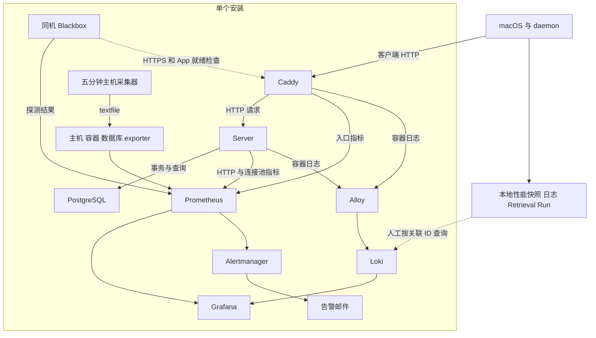

# Clumsies 可观测性设计方案

本方案供 Clumsies 开发、部署和性能评审人员使用，定义单个安装的指标、日志、本地诊断、看板和告警契约。运维操作见[可观测性运维排障指南](/zh/performance/observability-runbook)，测量证据见[HTTP 本地负载测试报告](/zh/performance/observability-load-report)。

## 目标与范围

可观测性支持四项判断：工作进入和完成的速率、完成耗时、失败影响，以及资源或执行阶段的等待。按 [Google SRE 四信号](https://sre.google/sre-book/monitoring-distributed-systems/)组织证据：吞吐量、延迟、错误和饱和度。总览确认影响，详情定位站点或操作，关联日志和阶段计时验证原因。

| 范围 | 观察对象 | 支持的判断 |
| --- | --- | --- |
| 中心性能 | Caddy 入口、Server handler、连接池、PostgreSQL、主机和容器 | 安装内请求表现与依赖、资源状态 |
| 运行保障 | 采集、日志、通知、备份、恢复、证书和发布记录 | 数据可信度及恢复保障 |
| 本地性能 | macOS 请求、daemon 同步、Commit 安装、索引、检索和模型执行 | 单个客户端的完成过程与阶段耗时 |
| 产品活动 | 保留记录、生命周期状态、冲突和未读存量 | 产品状态及保留记录的变化 |

吞吐量是单位时间内实际完成的工作量。容量是在确定硬件、数据规模和请求组合下，持续满足延迟与错误目标的负载；容量评估需要单独的负载测试。

## 采集架构

| 数据 | 采样与保留 | 用途 |
| --- | --- | --- |
| 中心请求与资源指标 | 默认 30 秒抓取，保留 90 天；请求图使用滚动五分钟窗口 | 同窗性能与资源比较 |
| 数据库与运行保障快照 | 主机采集器每五分钟执行 | 产品存量、活动查询、任务结果和成功时间 |
| 容器日志 | Alloy 发送至 Loki，保留 14 天 | 具体请求及入口、后端关联 |
| 本地性能快照 | 按实际操作记录，累计至进程退出 | 操作次数、当前并发和按结果划分的耗时分布 |
| Retrieval Run | 使用既有本地记录与清理规则 | 检索过程和质量证据 |

中心服务通过安装主机的 SSH 隧道访问。本地性能汇总和 Retrieval Run 保留在客户端；关联 ID 用于人工连接两侧证据。当前关联机制采用请求 ID，完整分布式追踪需要独立的 trace context。

Prometheus 标签限定为固定组件、操作、method、route template、结果类别和阶段。Loki stream 标签为 Compose project、service、container；请求 ID、原始路径和业务对象 ID 保留在日志字段中。Run 和文档等具体 ID 同样保留在本地或日志字段，版本使用独立信息指标与日志；query、正文和凭据按既有脱敏规则处理。[Prometheus 标签约定](https://prometheus.io/docs/practices/naming/)

## 指标契约

### 吞吐量与生命周期

入口请求、Server handler、客户端逻辑操作、同步尝试、索引构建和检索调用分别计数。层级之间通过关联 ID 对照；多次请求或重试仍属于各自的计数范围。

| 指标 | 维度 | 计数或快照边界 |
| --- | --- | --- |
| `caddy_http_request_duration_seconds_count` | host、code；`handler="subroute"` | 一个站点处理层完成的入口请求 |
| `clumsies_http_requests_total` | route、method、status | handler 返回 Response；100–599 保留实际码，其余归 `other` |
| `clumsies_http_business_requests_started_total` | route、method | API 请求进入 middleware |
| `clumsies_http_business_requests_terminated_total` | route、method、outcome | handler 以 `response` 或 `cancelled_or_aborted` 终止 |
| `clumsies_http_business_requests_in_flight` | route、method | 抓取时仍在执行的 API handler |
| `clumsies_db_pool_acquires_total` | operation、outcome | `review_create`、`review_merge` 的获取尝试；结果为 acquired、timeout、error、cancelled_or_aborted |

API 请求范围排除 `/metrics` 和 `/api/v1/admin/health`，保留 unmatched 请求，并包含后台轮询与重试产生的 HTTP 请求。响应吞吐统计返回 Response 的 handler；进入、中断和执行中数量分别展示。客户端逻辑操作按自身完成事件计数，例如先读取 revision 再提交更新产生两次 HTTP 请求，负载报告将其计为一次更新操作。Caddy 入口范围包含 synthetic probes，排除自动 HTTP 到 HTTPS 跳转。Server 日常查询要求现行 method 标签。Counter 先按原始 series 计算 rate/increase，再聚合，保留重启识别；increase 是窗口外推量，可出现小数。

数据库活动与产品存量使用 gauge。最近一小时记录数只统计 `now()-60min ≤ created_at ≤ now()` 的保留行；删除会减少计数。开放 Draft 净变化是六小时拟合存量斜率，以 Draft/小时表示。

### 延迟与结果

| 对象 | 起止边界 | 分类与覆盖 |
| --- | --- | --- |
| Caddy 入口 | 入口处理开始至站点处理层结束 | host、code；p50/p95 用于概览，p99 用于详情 |
| Server handler | middleware 进入至返回 Response | route、method、status_class；正文传输在该边界之后 |
| 连接获取 | `pool.acquire` 开始至连接、错误或中断 | 评审创建/合并；包含等待、验证和新建连接，事务 BEGIN 与执行另计 |
| 客户端 HTTP | 发起调用至完整响应接收与解码 | 本地观察 |
| 客户端操作 | 操作开始至约定结果可用 | 分别定义本地保存、Server 确认、Ref 安装和索引可检索 |
| daemon activate | 参数验证开始至 daemon 返回 | 包含查询与 history 确认等待；已接受的持久化可在后台继续，XPC 传输和客户端解码另计 |
| 后台工作 | 当次尝试开始至结果；原始待处理起点至收敛 | 尝试计数与积压年龄分别保存 |

HTTP histogram 统一使用 route、method、status_class。成功为 2xx/3xx，错误详情为 4xx/5xx/other；各类延迟配相同范围的样本数。分位数按滚动五分钟原始桶速率计算：先 rate，再按 le 和所选请求维度聚合，最后 histogram_quantile。多实例先聚合桶再计算分位数。Server 有限桶上界为 5、10、25、50、100、250、500 毫秒，以及 1、2.5、5、10、30 秒；超出有限桶的尾部受桶估计限制。[直方图语义](https://prometheus.io/docs/practices/histograms/)

当次耗时采用单调时钟，持久等待起点采用 UTC，跨机器分别保留各计时边界。跨层诊断比较同一请求的记录；分位数和重叠阶段的包含关系见运维指南的统计边界。

### 错误与饱和度

5xx、依赖超时、传输错误和取消分别保留。401、403、404、409、429 按操作契约判断影响；模型准备、主动取消、预期冲突和检索空结果分别归类。5xx 比例使用相同请求范围和窗口的分子、分母，同时展示失败次数。

| 对象 | 联合观察 | 口径 |
| --- | --- | --- |
| Server 连接池 | used、idle、open、max；acquire 耗时、结果和进行中次数 | pool gauges 为并发快照；acquire 仅覆盖评审创建与合并 |
| PostgreSQL | pg_up、连接数/上限、活动查询、锁和事务证据 | 主机 SQL 快照排除采集器自身及 idle transaction |
| CPU | 主机百分比、容器占用核数 | 0.5 CPU 秒/秒表示占用 0.5 核 |
| 内存 | 可用内存、工作集、配置上限、OOM 与交换 | 固定 2 GiB 提醒是绝对工作集阈值 |
| 磁盘 | 根分区及持久数据挂载的空间、I/O | 空间容量与读写延迟分别检查 |
| 本地模型与索引 | 活动执行、等待、worker 与待收敛工作 | 使用本地阶段记录 |

### 本地诊断

`Health.performance` 汇总固定操作名的 started、in_flight，以及各结果的 count、total_us、累计 buckets。bucket_upper_bounds_ms 给出有限桶上界，count 为 +Inf 桶。process_id、collection_started_at、snapshot_at 和单调 collection_elapsed_ms 标识采集进程及区间；进程重启清零。

区间分析保存同一 process_id、collection_started_at 的两份快照，对计数、耗时和桶取差值，并以 collection_elapsed_ms 差值计算速率；in_flight 读取当前值。重启或计数回退后重新建立采样区间。本地诊断可用时导出 performance.json，否则记录不可用；文件保留在客户端。

| 工作 | 本地证据 |
| --- | --- |
| 同步周期 | converged、partial、failed、skipped；sync lock 等待与执行分别记录 |
| Draft | 同步尝试、Server ACK、本地 synced 提交；oldest_pending_operation_at 覆盖可访问项目的 queued/syncing/retrying，oldest_failed_operation_at 覆盖 failed；均保留原始入队时间 |
| Commit | 项目级 commit_sync.last_checked_success_at 记录可信检查，包括无变化结果；Ref 安装时间独立。全局状态和 Draft channel 的 checked 字段为 None |
| 索引 | 构建、发布、superseded 和维护结果；pending_since 跨目标更新与重试保持，收敛后清除；published_at 在原子发布后推进 |
| 检索 | activate 返回耗时、Run、锁等待、模型 gate、blocking 排队、实际执行和 history 持久化；Run.total_us 从校验后起点至查询结束，history 阶段另计 |

检索在参数校验后建立统一 60 秒截止时间，查询与常规 history 确认等待共用剩余预算。后台 writer 负责已接受的历史任务，获取 history 锁后持有至实际完成；确认等待到期后，调用可返回，持久化继续执行，Run 在提交前可能仍为 running。持久化失败单独记录，技术响应与历史终态分别核对。history_lock_wait 和 history_persistence 观察实际后台阶段；activate 观察调用返回。初始 Run 创建、超时终态写入及故障记录保留各自等待边界，完整 daemon 耗时使用 activate 快照。

索引 pending_since 从收敛后的首个未解决目标开始，跨重试和目标变化保持；新积压保留较早的 published_at。模型 gate 等待、blocking 排队和实际执行分别计时；调用者取消后，blocking 工作可能继续，资源所有权随实际执行结束释放。本地数据契约见[本地运行时](/zh/runtime)和[检索与评测](/zh/retrieval-evaluation)。

## 数据可信度

| 状态 | 判定与处理 |
| --- | --- |
| 有活动 | 来源可达、字段和时间有效，展示吞吐量、分类分布及样本 |
| 空闲 | 来源可信、窗口无事件，吞吐为零，延迟无样本 |
| 失败 | 抓取、SQL 或任务失败；保留最近尝试结果和最后成功记录 |
| 缺失 | 预期 target 或必要字段缺失，显示未知 |
| 过期 | 主机或数据库采集年龄超过 900 秒，快照及当前任务判断显示未知 |
| 时间无效 | 过去事件戳晚于观察时钟，显示 -2 并保留原戳 |
| 未执行或未覆盖 | 阶段没有样本，按相应状态显示 |
| 年龄未知 | 持久工作缺少可信起点，保留未知 |

`clumsies_observability_expected_target` 来自目标清单；target_health 对每个预期 job/instance 输出 1 正常、0 抓取失败、-1 缺失。有效数据库快照要求 SQL success=1，且主机、数据库年龄均满足 `0 ≤ age ≤ 900 秒`。过期/缺失为 -1、失败为 0、有效为 1；未来时间严格按无效处理。

SQL 失败撤掉数据库样本；textfile 的真实采集时间决定新鲜度。备份、恢复、发布的原始成功时间中性保留，与当前可信度分开展示。新可信成功可修复未来缓存；仍处于未来的原始收据或归档继续显示时间异常。任务状态区分 success、failed、never、missing、running；明确的启动失败允许没有退出时间，存在未来退出时间时按无效处理。证书到期属于未来期限，使用剩余有效期判断。

## 看板与导航

四个看板分别提供影响、入口、API 和运行保障视图，中英文采用相同查询。设计依据见 [Grafana 看板组织实践](https://grafana.com/docs/grafana/latest/visualizations/dashboards/build-dashboards/best-practices/)。

| 看板 | 内容 | 导航 |
| --- | --- | --- |
| 运行总览 | 告警与可信度；API 请求吞吐量、分类样本、成功延迟；5xx、API 请求并发、连接池；四站点入口 | 站点到入口页，请求到 API，资源与采集到基础设施 |
| 入口与网站访问 | site 筛选、请求/s、状态码、延迟和样本、慢请求及访问日志 | 请求关联到 API 页 A7 |
| 业务 API | route/method 筛选、吞吐与分类延迟、忙/慢路由、生命周期、请求关联；折叠产品活动区 | App 入口到 W5，依赖到基础设施 |
| 基础设施与运行保障 | 预期目标、快照、数据库、资源、备份、恢复、证书、日志、通知、Server 版本和发布信息 | Prometheus、Alertmanager、运维指南 |

跨页链接保留时间和适用的 site、route、method、request_id。API 的 A7 是 Caddy/Server 共用关联区，也是手工请求 ID 的唯一输入位置，以完整 request ID 查询，两层日志在同一结果中展示。页面级导航承担视图切换；面板保留测量结果。

摘要卡以标题标明对象，正文只显示一个结果。抓取状态、快照状态、采集时效、成功时间和记录可信度分别使用独立卡片；分位数、站点及路由等同类时序在同图比较。时间与距今时长分别带各自单位。API 请求/s、日志条目/s、连接获取次数/s、CPU 核数及天数按实际计数对象标明。

本地 server_request_id 可直接关联入口与 Server。client_request_id 先定位 Server 记录，再取内部 request_id；同一客户端身份可覆盖多个尝试。检索的 retrieval_run_started 连接 request_id 与 run_id。产品活动使用 API 折叠区的八个 gauge，配快照状态与年龄。

## 服务目标与告警

沿用[部署指南的服务目标](/zh/guides/deploy-for-an-org#服务目标)。采集正确性、运行保障和服务目标合规分别验收。

| 目标 | 数值 | 测量要求 |
| --- | --- | --- |
| 公网可用性 | 30 天 99.5% | App 为 HTTP 200 且 JSON status=ok；静态站点使用 HTTPS 模块，报告探测覆盖与缺失 |
| 写入新鲜度 | 99% 合格改动在五分钟内到 Server | 首次持久化入队至验证对应 Server 持久确认；完整 SLI 待实现 |
| 持久性 | RPO ≤ 26 小时；RTO ≤ 1 小时 | 可恢复副本和成功备份年龄；恢复开始至恢复后可用的独立计时 |
| App 入口延迟 | p95 < 1 秒 | Caddy App 入口；请求范围和目标窗口待明确 |
| 服务端错误 | <1% | 每站点同组入口请求的 5xx；API route/method 用于定位 |

写入 SLI 按首次入队归属窗口。到达 300 秒判定点的合格逻辑操作构成分母，300 秒内取得对应确认的操作构成分子；未到期 pending 单列并报告窗口滞后。重试沿用同一逻辑操作，迟到成功保留原判定；合并、取消和无需上传操作的处理需预先写入合格事件契约。客户端接收时间是可验证的确认上界。

告警覆盖可行动的故障、容量风险和观测链路故障。低流量结合失败次数、比例和操作价值判断；产品存量用于工作状态分析。

| 规则组 | 条件与持续时间 | 排查入口 |
| --- | --- | --- |
| 可用性 | 公网探针失败 2 分钟；抓取失败或预期目标缺失 5 分钟；证书不足 14 天持续 1 小时 | 站点、target、证书 |
| 入口错误 | 每站点滚动五分钟 5xx >1%，持续 5 分钟 | 入口日志、API |
| 容量 | 文件系统可用量 <15%、主机可用内存 <10%、PostgreSQL 连接 >80%，各持续 10 分钟 | 资源、数据库 |
| 固定内存提醒 | 容器工作集 >2 GiB，持续 10 分钟 | 容器趋势与实际限制 |
| 数据库 | pg_up=0 持续 2 分钟；有效快照中活动查询 >60 秒持续 5 分钟 | 数据库、锁与事务 |
| 采集 | 主机/数据库快照缺失、失败、过期或时间无效，持续 5 分钟 | service/timer、textfile、SQL |
| 时间有效性 | OperationalTimestampInvalid：node 可达且主机/DB 采集、备份、恢复、发布或 unit exit 戳 >Prometheus time，持续 5 分钟，warning | 主机时钟和对应原始记录 |
| 日志与通知 | 发送重试持续 5 分钟；五分钟内存在日志丢弃或通知失败 | Alloy、Loki、Alertmanager |
| 备份与恢复 | 成功备份缺失/时间无效/>26 小时持续 30 分钟；成功演练缺失/时间无效/>8 天持续 1 小时；任务失败或不可用持续 5 分钟 | service/timer、任务结果、成功记录 |

普通邮件初次等待 30 秒，分组变化间隔五分钟，持续故障每四小时重复，恢复发送通知。warning/critical 使用同一接收器。Watchdog 常驻 firing，首次等待 10 秒、每 24 小时重复；收件箱实际收到心跳用于验证投递。通知应给出对象、窗口、结果或样本、详情入口及首个排查动作。

## 验收与待完善项

| 范围 | 验收结果 |
| --- | --- |
| 看板与导航 | 八个中英看板查询一致，原指标有明确去向，时间与适用筛选保持 |
| HTTP 分类 | method 隔离，成功/错误各有分布和样本，504/599 归 5xx |
| 生命周期 | started、response、cancelled_or_aborted、in-flight 范围一致；取消终止平衡计数 |
| 连接获取 | 评审创建/合并范围隔离；获取、超时、错误、中断和进行中正确 |
| 数据可信度 | timer 停止、SQL 失败、target 缺失、未来时间和缓存恢复可见 |
| 运行保障 | never/failed/missing/running 区分，最近失败与最后成功并存 |
| 请求证据 | 入口/handler/正文传输边界明确，完整 ID 精确关联，日志脱敏有效 |
| 本地诊断 | 进程区间、同步确认、本地提交、索引发布、activate 返回与后台持久化、阶段执行状态可验证 |

配置与行为验收使用 `deploy/observability/test.py`、`test-delivery.py`、Server metrics/telemetry 和本地行为测试。失败注入与负载测试采用隔离环境；生产使用真实流量和就绪检查。字段或完成点调整同时更新查询、规则和 fixtures。

待完善项：写入 SLI 的合格事件、首次确认持久去重和到期未完成分母；入口延迟与错误目标的观察窗口及请求范围；各类操作的响应预算；RTO 独立计时；主机外监测与告警责任、通道。当前同机监控的有效范围是安装内组件与探针，整机失联和通知通道自身故障需外部观察。

统计解释遵循以下边界：低样本 p99 配样本数阅读；窗口无事件时延迟无样本；入口、handler、客户端及重叠阶段分别计时；五分钟数据库快照覆盖采样时状态；产品保留行数描述活动存量。检索质量另用人工评测，容量结论另列硬件、数据规模、请求组合及持续时间。

## 附录 A：历史数据与升级

日常看板采用 route、method、status_class 的现行 HTTP schema。历史 route-only histogram 为混合结果，升级前数据保留在 Prometheus；查询历史时按当时标签解释。历史全路由 in-flight 包含 health 与 metrics，现行 API 请求视图使用排除运维路由的 in-flight。升级后等待完整五分钟窗口再读取分类延迟。

旧 daemon 缺少 performance 或持久等待起点时，本地诊断显示不可用或年龄未知。客户端保持旧响应解码兼容。配置升级与回滚由现有交付流程执行；成功时间及历史指标保留，历史样本按原始口径解释。五分钟发布快照记录最近成功，历史 revision 对照使用发布记录。

## 附录 B：原 40 项面板去向

O 为原运行总览，A 为原业务 API，W 为原网站访问；I 为基础设施，P 为 API 的折叠产品活动区。原三个看板 UID 保留，跨看板收藏按表更新；页面级导航替代纯帮助面板。

| 源 ID | 原面板 | 现行去向 |
| --- | --- | --- |
| O1 | 站点可用性 | O1，逐站点 |
| O2 | 入口请求/s | O2 → W |
| O3 | 站点 5xx | O3，配同窗样本 |
| O4 | 入口 p95 | O4 → W |
| O5 | 备份年龄 | I16，成功年龄；I29，成功时间 |
| O6 | 证书剩余天数 | I19，逐证书 |
| O7 | 根分区空间 | I14，持久挂载空间 |
| O8 | 主机 CPU | I10，百分比 |
| O9 | 主机内存 | I11，可用量与压力 |
| O10 | 容器 CPU | I12，占用核数 |
| O11 | 容器内存 | I13，工作集与限制 |
| O12 | PostgreSQL 连接 | I5，连接数与上限 |
| O13 | 最长查询 | I9，有效采样快照 |
| O14 | 抓取目标 | I1，预期目标状态；O 提供摘要 |
| O15 | 日志重试/丢弃 | I20 |
| O16 | Loki 日志发送/s | I21，配来源与传输状态 |
| A1 | handler 延迟 | A1，成功分类；错误分布另列 |
| A2 | 观测请求量 | A2，总量与分类样本 |
| A3 | 状态码请求/s | A3 |
| A4 | >1 秒请求 | A4，调查筛选 |
| A5 | 后端慢请求 | A5，route/method 与请求 ID |
| A6 | App 入口慢请求 | API 页级“App入口”导航 → W5 |
| A7 | 请求关联 | A7，统一关联区 |
| A8 | Server 连接池 | I4，配有限 acquire 计时 |
| A9 | 最忙路由 | A9，route/method 下钻 |
| A10 | 最近一小时 Commit | P / A10，保留行 gauge |
| A11 | 最近一小时 Draft | P / A11 |
| A12 | 最近一小时 Review | P / A12 |
| A13 | Draft 生命周期 | P / A13 |
| A14 | 开放 Draft 净变化 | P / A14，六小时拟合 |
| A15 | 有效对账冲突 Draft | P / A15，候选有效性范围 |
| A16 | 数据库未读记录 | P / A16，含归档与不可访问记录 |
| A17 | 最早开放 Draft 创建年龄 | P / A17，无 open 时为零 |
| W1 | 入口延迟 | W1，p50/p95/p99 与样本 |
| W2 | 观测请求量 | W2，窗口外推量 |
| W3 | 状态码请求/s | W3 |
| W4 | >1 秒请求 | W4 |
| W5 | 站点慢请求 | W5，路径、字节与上游计时 |
| W6 | 访问日志 | W6 |
| W7 | 请求关联 | 网站页级“请求关联”导航 → A7 |
