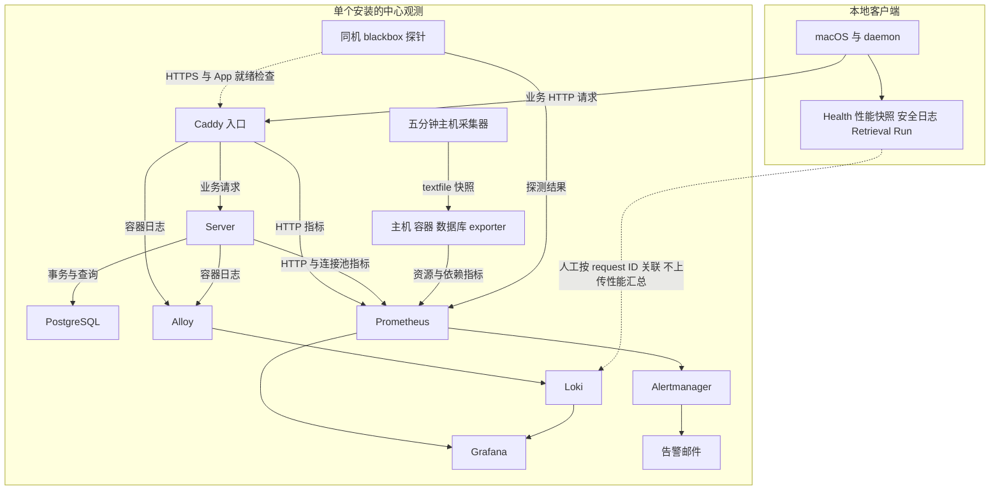
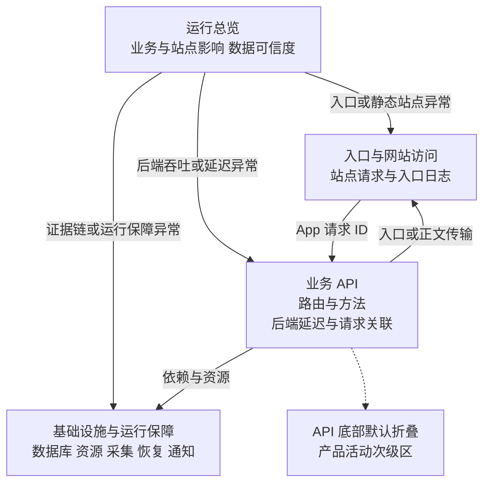
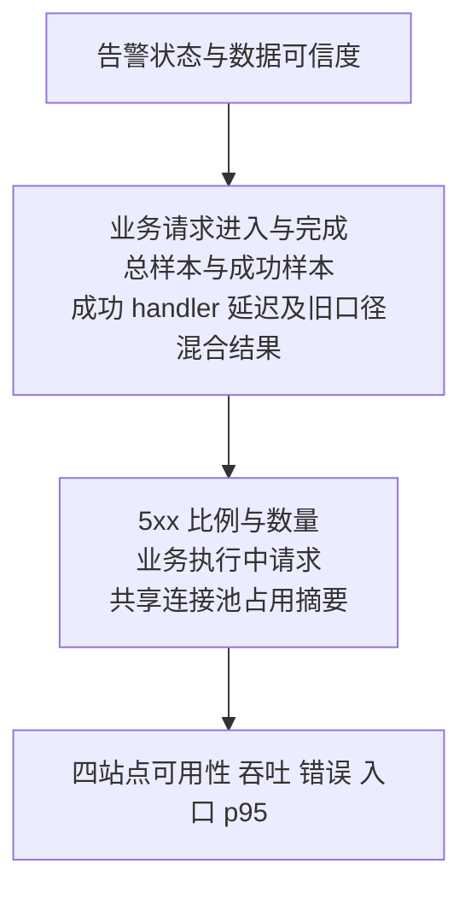

# Clumsies 可观测性设计方案

面向负责 Clumsies 开发、部署与性能评审的工程师，定义采集边界、指标口径、数据质量、看板职责和告警条件。性能判断以吞吐量和延迟为主线，结合错误与饱和度寻找原因；现场操作使用[可观测性运维排障指南](/zh/performance/observability-runbook)。

| 规范信息 | 内容 |
| --- | --- |
| 核对日期 | 2026 年 10 月 13 日 |
| 中心数据契约 | Server HTTP 指标含 method、结果分类及业务请求生命周期；连接获取计时仅覆盖评审创建与合并事务 |
| 兼容范围 | 旧 route 型 HTTP 指标继续可读，混合结果延迟与全路由并发单独标注 |
| 客户端数据归属 | macOS 与 daemon 诊断保留在本地，不向中心 Grafana 上传性能汇总或 Retrieval Run |
| 生效条件 | 安装采用匹配的数据契约、采集配置与看板，并通过本文验收；生产启用状态以该安装的发布记录为准 |

## 目标与范围

观察者应能在同一时间窗内确定：进入和完成了多少工作，一次工作需要多久，失败影响多大，哪个阶段开始等待。总览负责确认影响，详情负责缩小到站点、路由或操作，日志与本地诊断负责验证同一次工作的过程。

实际吞吐量是已完成的工作量，例如每秒完成 10 次请求。容量是在指定硬件、请求组合和数据规模下，持续满足延迟与错误目标的负载。日常低负载、单次峰值或一张 CPU 曲线均不能直接证明容量。

| 范围 | 观察对象 | 不应推导的结论 |
| --- | --- | --- |
| 中心性能 | Caddy 入口、Server handler、共享连接池、数据库和资源 | 服务端正常不等于客户端同步、界面或检索正常 |
| 运行保障 | 采集、日志、通知、备份、恢复、证书和发布记录 | 抓取成功不等于业务成功；同机监控不能独立报告整机失联 |
| 本地性能 | 客户端请求、同步、Commit 安装、索引与检索、模型执行 | 本地过程统计不等于全体客户端统计或持久的写入 SLI |
| 产品活动 | 保留记录数、生命周期状态、冲突与未读存量 | 存量、创建年龄和拟合净变化不等于吞吐量、同步延迟或故障积压 |

采用 [Google SRE 的四信号](https://sre.google/sre-book/monitoring-distributed-systems/)组织性能观察：流量、延迟、错误、饱和度。信号相关性形成排查假设；判断原因仍需同一请求或任务的阶段证据。

## 采集架构

保持现有 Prometheus、Grafana、Loki、Alloy、Alertmanager 和 exporter，不为每个组件建立独立监控栈。业务请求与遥测各自沿实际边界流动，本地证据通过关联 ID 与 Server 日志连接。

| 数据 | 采样或保存策略 | 主要用途 |
| --- | --- | --- |
| 中心请求与资源指标 | 默认每 30 秒抓取；请求看板使用滚动五分钟窗口；保留 90 天 | 比较同窗吞吐量、延迟、错误与资源 |
| 数据库和运行保障快照 | 主机采集器每五分钟执行 | 存量、长查询、备份和任务结果；每项结合采集时间 |
| 容器日志 | Alloy 发送到 Loki；保留 14 天 | 从异常窗口定位具体请求并关联入口与后端 |
| 本地过程统计 | 按实际事件记录，按进程生命周期汇总 | 本地操作次数、结果和耗时分布；明确采集起点与重启边界 |
| 本地 Retrieval Run | 沿用运行记录及清理契约 | 检索过程和质量证据；保留行数只能表示可见历史样本 |

中心服务通过安装主机的 SSH 隧道访问。request_id 留在日志中；只有引入真实 trace context 后才使用标准 trace_id 和 span_id。本方案的关联能力不等于完整分布式追踪。

指标维度限定为固定组件、操作、HTTP method、route template、结果类别与阶段。请求、Run、文档和项目 ID、原始路径、query 与正文不进入 Prometheus 标签或 Loki stream 标签。版本放在独立信息指标与日志；Loki 的 project 标签是 Compose 项目名，不是业务 Project ID；本地具体对象按既有权限查看。[Prometheus 命名与标签约定](https://prometheus.io/docs/practices/naming/)

## 四信号指标规范

### 吞吐量与工作量

入口请求、Server handler、客户端逻辑操作、同步尝试、索引构建和检索调用分别计数。一项逻辑操作可以产生多次请求与重试，各层计数不能相加，也不能用数据库保留行数代替事件计数。

| 指标 | 维度或结果 | 单位与完成边界 |
| --- | --- | --- |
| `caddy_http_request_duration_seconds_count` | host、code，限定 `handler="subroute"` | 入口处理完成请求数；rate 为请求/秒 |
| `clumsies_http_requests_total` | route、method、status | 返回 Response 的 handler 次数；status 保留 100 至 599 的实际码，其它码归 other |
| `clumsies_http_business_requests_started_total` | route、method | 进入业务 middleware 的次数 |
| `clumsies_http_business_requests_terminated_total` | route、method、outcome | 当次 handler 终止；区分 response 与 cancelled_or_aborted |
| `clumsies_http_business_requests_in_flight` | route、method | 正在执行的业务 handler 数，属于抓取时快照 |
| `clumsies_db_pool_acquires_total` | operation、outcome | review_create、review_merge 的连接获取尝试；区分 acquired、timeout、error、cancelled_or_aborted |

Server 看板与业务生命周期指标统一排除 `/metrics` 和 `/api/v1/admin/health`；unmatched 请求仍计入。Caddy 选取一个 subroute 处理层，避免重复累加 middleware；该口径包含 synthetic probes，不包含自动 HTTP 到 HTTPS 跳转，不能称为访客流量。

Counter 先对原始 series 使用 rate 或 increase，再按所需维度聚合，以保留重启识别。increase 是窗口外推估计，可能出现小数。业务 gauge 直接表示快照；Draft 净变化采用存量斜率，仍不能命名为创建或完成速率。

### 延迟与结果边界

| 对象 | 起止边界 | 展示规范 |
| --- | --- | --- |
| Caddy 入口 | 入口处理开始至该层完成请求处理 | 按站点展示入口 p50/p95；p99 用于详情调查，不写成浏览器加载时间 |
| Server handler | middleware 进入至返回 Response | histogram 按 route、method、status_class 分桶；不包含完整正文传输 |
| Server 成功与错误响应 | 成功分类为 2xx/3xx；错误详情为 4xx/5xx/other | 分别展示耗时与各自样本数；快速失败不能降低成功延迟的判断标准 |
| 连接获取 | pool.acquire 开始至得到连接、错误或中断 | 含等待、验证及新建连接；仅覆盖评审创建/合并事务，不含 BEGIN 或事务执行，不命名为纯排队时间 |
| 客户端 HTTP | 发起调用至完整响应接收与解码 | 在本地查看，不用 handler 延迟替代 |
| 客户端操作 | 操作开始至约定结果可用 | 本地保存、Server 确认、Ref 安装和索引可检索分别定义完成点 |
| daemon activate | 参数验证开始至查询和 history 完整收尾后返回 | 过程统计包含收尾，不包含 XPC 响应传输与客户端解码；Run.total_us 另有较短边界 |
| 后台尝试与收敛 | 当次执行至当次结果；原始待处理状态至目标结果可用 | 重试计尝试但不重置原始等待起点；未完成操作显示状态与年龄 |

`clumsies_http_request_duration_seconds` 的新维度是 route、method、status_class，类别为 2xx、3xx、4xx、5xx、other。旧仅 route 的 histogram 只能展示“旧口径混合结果”，不能标为成功 p95。method 筛选同样需要相应新样本；无新样本本身不能证明功能不受支持。

请求图的分位数均为滚动五分钟桶估计。先 rate，再按 le 和业务维度聚合，最后计算 histogram_quantile；不平均多个实例的 p95。尾部超出最后有限桶时仍受桶边界限制，必须同时看样本数。[Prometheus 直方图语义](https://prometheus.io/docs/practices/histograms/)

各进程用单调时钟测量当次耗时，用关联 ID 连接证据，不减两台机器的墙上时间。持久化等待起点用 UTC 时间并识别异常；未保存可信起点的历史工作标为年龄未知。两层分位数不能相减得到网络耗时，重叠阶段不能相加得到完整响应耗时。

### 错误

5xx、依赖超时、传输失败与取消分别保留。401、403、404、409、429 根据操作契约判断影响，不能一律计为服务故障；模型准备中、主动取消、预期冲突和检索空结果也不应自动报警。

5xx 的分子、分母和时间窗必须一致。新版 Server 可按实际 status_class 统计全部 5xx；旧 counter 白名单兼容查询可能把部分码归为 other，应保留该限制。已观测有请求且没有 5xx 时可以显示零错误；整个数据源缺失时保持未知。

HTTP 返回成功只证明该层的响应结果。写入确认、本地 synced 提交、共享发布和检索可用需要各自的事件，不能由 2xx 次数推断。

### 饱和度与资源

资源使用说明“消耗了多少”，等待与积压说明“是否开始受限”。连接获取进行中可能包含验证和新建连接，不能直接当作队列长度；in-flight 是并发快照，不能代替进入计数。

| 对象 | 必须结合的信号 | 解释边界 |
| --- | --- | --- |
| Server 连接池 | used、idle、open、max；评审事务 acquire 耗时、结果、进行中次数 | 连接获取只覆盖 review_create/review_merge；不能宣称全数据库等待已覆盖 |
| PostgreSQL | pg_up、连接数/上限、长查询与实际锁/事务证据 | 五分钟最长查询快照可以遗漏短时拥塞 |
| CPU | 主机使用百分比、各容器占用核数 | 0.5 CPU 秒/秒表示占用 0.5 核 |
| 内存 | 可用内存、工作集、实际限制、OOM 与交换证据 | 未配置容器限制时，固定 2 GiB 提醒不是容量百分比 |
| 磁盘 | 根分区和承载数据库、日志、指标的实际挂载空间；I/O 证据 | 空间不足与 I/O 变慢分别调查 |
| 本地模型与索引 | worker 或模型活动、等待、真实执行和待收敛工作 | 只在本地诊断；阶段计时的覆盖范围由实际字段决定 |

### 本地诊断契约

本地 Health.performance 以固定操作名与结果分类汇总 started、in_flight 和 outcomes[result] 的 count、total_us、累计 buckets；bucket_upper_bounds_ms 给出有限桶的毫秒上界，count 同时表示 +Inf 桶。process_id、collection_started_at、snapshot_at 和单调时钟 collection_elapsed_ms 标识统计所属进程及采集区间。重启清零；这些统计不构成中心 Grafana 的客户端覆盖率，也不代替持久 SLI。

单份快照覆盖该进程自采集初始化以来的全部观察，不对应 Grafana 所选的五分钟窗口。调查一个区间时，保存同一 process_id 且 collection_started_at 相同的两份快照，对 started、结果 count、total_us 与累计桶分别取差值，并用 collection_elapsed_ms 的差值计算速率；in_flight 直接读取当前快照。进程重启或计数回退时重新建立区间，不跨进程相减，也不把缺失操作或结果补成已观察样本。

| 本地对象 | 区分的工作和结果 | 计时或状态要求 |
| --- | --- | --- |
| 同步周期 | converged、partial、failed、skipped 等结果 | 锁等待与周期执行分别记录；周期返回 Ok 不等于全部 Draft 收敛 |
| Draft | 当次同步尝试、实际 Server 确认、本地 synced 提交 | oldest_pending_operation_at 与 oldest_failed_operation_at 表示可访问工作原始入队时间；重试不重置，failed 年龄不是失败发生时间 |
| Commit | 成功检查、无变化检查、实际 Ref 安装 | 选择具体项目后读取 commit_sync.last_checked_success_at；无项目范围及 Draft channel 的此字段为 None，不是全局检查时间；安装时间另列 |
| 索引 | 构建尝试、实际发布、superseded、维护结果 | pending_since 表示当前积压起点；published_at 仅真实原子发布后更新；目标版本差不等于任务或文档数 |
| 检索 | 完整 activate 调用、Run、锁等待、模型等待/执行及记录收尾 | activate 过程计时覆盖参数验证至 history 收尾；Run.total_us 在收尾前截止，60 秒查询预算不约束完整调用 |

索引 pending_since 在已收敛后首次出现新目标时设置，跨重试和目标更新保持，收敛后清除；新积压保留旧 published_at。升级前的历史积压缺少可信起点时不回填。同步的 pending/failed 年龄来自原始操作创建时间，不从索引 job.created_at、updated_at 或 Run 保留行数补造年龄和吞吐量。首次 Server 确认的持久去重及全体合格操作分母仍是写入 SLI 的独立要求。本地接口与数据归属见[本地运行时](/zh/runtime)、[检索与评测](/zh/retrieval-evaluation)。

## 数据质量状态

性能图必须与来源状态一起阅读。历史有效曲线可以保留，缺失或冻结时不能继续宣称当前正常。

| 状态 | 判定 | 展示及处理 |
| --- | --- | --- |
| 正常有活动 | 来源可达，所需字段和时间有效，存在事件 | 展示吞吐量、结果、分布及各自样本量 |
| 正常空闲 | 来源可信，窗口没有事件 | 吞吐可为零，延迟显示无样本，不能显示 0 ms 成功 |
| 失败 | 抓取失败、SQL 失败或当次任务失败 | 显示失败，并保留最近成功与最近尝试结果 |
| 缺失 | 预期 target 不存在或必要字段未提供 | 显示缺失/未知，不能通过求和把消失的目标忽略 |
| 过期 | 主机或数据库快照超过 15 分钟 | 标为过期；产品 gauge、最长查询和当前运行保障状态不参与正常判断 |
| 时间无效 | 采集或已经发生的成功/退出事件戳晚于观察时钟，年龄为负 | 显示 -2 时间无效，不能钳成零或判为新鲜；保留原始戳供核对 |
| 未覆盖或未执行 | 安装未提供该埋点，或当次操作未执行该阶段 | 明确范围；不补零参与分位数 |
| 年龄未知 | 历史工作没有可信积压起点 | 保持未知，不用创建时间或重试时间替代 |

`clumsies_observability_expected_target` 由部署目标清单产生；`clumsies_observability_target_health` 对每个预期 job/instance 输出 1 正常、0 抓取失败、-1 缺失。旧配置兼容状态只覆盖已发现目标，不具备误删目标检测能力。

数据库快照有效需要 `clumsies_database_collection_success=1`，并且数据库与主机采集年龄均满足 `0 ≤ age ≤ 900 秒`。未来采集时间、时钟回拨造成的负年龄均不可信，不设隐含容差。SQL 失败撤掉数据库样本；timer 停止时 node-exporter 仍可能重读旧 textfile，因此 Prometheus 样本时间不能证明快照新鲜。运行保障另看主机采集时间和任务状态 success、failed、never、missing、running。

备份、恢复和发布的最后成功时间作为历史事实保留，后续失败或时间异常不改写成功戳。备份/恢复的有效年龄与已完成任务结果需要新鲜、非负的主机采集时间；未来成功或退出时间不能证明正常。看板用中性字段保留原始成功戳，另列可信度或有效年龄，缺失/过期为未知，未来时间为无效。明确的启动失败可以没有退出时间，仍应显示失败；已有退出时间在未来时标为无效。最近失败、从未成功和最后成功年龄分别表达。证书到期时间本来位于未来，不属于过去事件的这一约束。日志发送为零可以是空闲，成功发送也不能证明每个来源都配置正确。

## 四个主看板

保留运行总览、业务 API、入口与网站访问的原 UID，新增基础设施与运行保障；中英版本使用相同查询。按影响和排查任务组织页面，资源与产品存量不占据性能总览。[Grafana 看板组织实践](https://grafana.com/docs/grafana/latest/visualizations/dashboards/build-dashboards/best-practices/)

| 看板 | 页面布局 | 下钻 |
| --- | --- | --- |
| 运行总览 | 顶行告警与可信度；业务吞吐/样本/handler 延迟；5xx/并发/连接池摘要；四站点入口信号 | 站点到入口页，业务到 API，依赖和证据异常到基础设施 |
| 入口与网站访问 | site selector；请求/s和状态码；延迟及样本；超过 1 秒请求；慢日志与全部访问日志 | App 的具体请求到统一关联区；静态请求自然没有 Server 记录 |
| 业务 API | route/method selector；吞吐、分类样本与延迟；忙/慢路由、5xx及生命周期；具体日志和关联区 | route 保留 method；入口日志复用站点页；连接池复用基础设施页 |
| 基础设施与运行保障 | 预期目标与快照状态；数据库和有限连接获取计时；主机/容器/磁盘；备份/恢复/证书/日志/通知；版本与成功发布快照 | 到对应服务、timer、日志和告警页面；保持异常时间窗 |

总览布局按阅读顺序排列，资源只放异常摘要或有限概况：

所有跨页链接保留时间范围，site、route、method、request_id 仅传给相应视图。API 只有一个跨 Caddy/Server 的请求关联区，忽略站点和路由筛选，避免筛掉另一层。空 request_id 提示输入并不返回日志；静态配置仍可发送受约束的 Loki 查询，不承诺完全不查询。

本地 HTTP 日志的 server_request_id 来自返回头，可直接关联入口与 Server；Server 的 client_request_id 对应客户端身份，先找到 Server 记录后用其内部 request_id 查入口。客户端身份可能覆盖多个 HTTP 尝试，不能把这些尝试的计时拼成同一次 HTTP 请求。检索通过 retrieval_run_started 事件连接 request_id 与 run_id，再查看对应本地 Run。

产品活动导航打开 API 页，并明确提示展开页底部次级区，不依赖 row 的单面板跳转。八个产品 gauge 保留原语义和源 ID；各项受快照有效性约束，该区不参与自动故障判定，不新增第五个主看板。

旧全路由 `clumsies_http_requests_in_flight` 包含 health 和当前 metrics 抓取，仅作为明确标注的兼容信息，不用于业务积压判断。版本信息和最后成功发布时间辅助对照发布记录；五分钟发布快照不是完整事件历史或 revision 映射。

## 服务目标与告警规范

沿用[部署指南的服务目标](/zh/guides/deploy-for-an-org#服务目标)。SLI 是具体测量，SLO 是目标；指标存在、一次演练成功或规则未报警均不代表目标已经达标。

| 目标 | 数值 | 测量范围与验收条件 |
| --- | --- | --- |
| 公网可用性 | 30 天探测成功率 99.5% | App 按 HTTP 200 且 JSON status=ok 判断 ready，静态站点按 HTTPS 模块判断；展示探测覆盖率和缺失，整机失联另需主机外观察 |
| 写入新鲜度 | 99% 合格客户端改动在五分钟内到 Server | 首次持久化入队到收到并验证对应 Server 持久确认；尚未形成完整 SLI，不能报告已达标 |
| 持久性 | RPO 不超过 26 小时；RTO 不超过 1 小时 | 验证可恢复副本和成功备份年龄；恢复开始到恢复后服务可用另行计时，演练成功年龄不等于 RTO |
| App 入口延迟 | p95 低于 1 秒 | 保持 Caddy App 入口计时；请求范围及目标窗口需明确，不能改绑 Server 成功 p95 或浏览器体验 |
| 服务端错误 | 少于 1% | 入口按站点评估同组请求的 5xx；保留现有规则，API method/route 用于定位原因 |

写入 SLI 按首次入队时间归属观察窗口，对已经达到 300 秒判定点的合格逻辑操作计算好事件/全部事件，并显示窗口滞后与未到期 pending。300 秒内取得对应确认才为好事件；到期未确认就是坏事件，即使之后成功。重试不新增分母，取消或合并不得事后任意删除坏事件。本地无需上传操作是否排除，应预先写入合格事件契约。客户端确认时间是可验证的接收上界，不是 Server 内部精确提交时间。

当前本地过程计数缺少完整合格事件契约、首次确认的持久去重和未完成分母，不能替代上述 SLI。入口延迟与错误 SLO 的观察窗口和请求范围、其它操作响应预算、外部整机监测方式及告警责任/通道需由服务维护方确认。

### 告警判定

告警针对可行动的故障、即将耗尽的容量和证据链失败。人类工作存量、Draft 创建年龄、未读数、空结果或 CPU 单次升高不自动通知运维。低流量同时展示失败次数与比例，不能统一抑制高价值写入失败。

| 规则组 | 条件与持续时间 | 排查入口 |
| --- | --- | --- |
| 可用性 | 公网探针失败 2 分钟；抓取失败或预期目标缺失 5 分钟；证书不足 14 天持续 1 小时 | 站点、预期 target、证书 |
| 入口错误 | 每站点滚动五分钟 5xx 比例大于 1%，持续 5 分钟 | 入口错误日志和对应 API |
| 容量 | 文件系统可用量低于 15% 持续 10 分钟；主机可用内存低于 10% 持续 10 分钟；PostgreSQL 连接超过 80% 持续 10 分钟 | 基础设施资源与数据库 |
| 固定内存提醒 | Clumsies 容器工作集超过 2 GiB 持续 10 分钟 | 容器趋势；该值不是配置上限 |
| 数据库 | pg_up=0 持续 2 分钟；最长活动查询超过 60 秒持续 5 分钟 | 数据库；长查询仍是五分钟快照 |
| 采集 | 主机快照缺失/超过 15 分钟或数据库快照失败/缺失/过期，持续 5 分钟 | metrics service/timer、textfile 与 SQL |
| 时间有效性（OperationalTimestampInvalid，warning） | node 可达时，主机/数据库采集、备份、恢复、发布或 unit exit 时间晚于 Prometheus 当前时间，持续 5 分钟 | 核对主机时钟及原始记录；分别标记无效来源，不重写历史 |
| 日志与通知 | 日志发送重试持续 5 分钟；五分钟内有丢弃或通知失败 | Alloy、Loki、Alertmanager 与通知集成 |
| 备份与恢复 | 成功备份缺失或超过 26 小时持续 30 分钟；成功演练缺失或超过 8 天持续 1 小时；最近任务失败或不可用持续 5 分钟 | 相应 service/timer，最近结果与保留成功时间 |

每条通知应包含受影响对象、窗口、结果或样本、详情入口和首个排查动作。Prometheus 展示 enabled、pending、firing，Alertmanager 处理通知分组与静默。当前 warning 和 critical 使用同一邮件接收器，严重度标签本身不提供不同响应优先级。

普通通知初次等待 30 秒，分组变化间隔五分钟，持续故障每四小时重复，恢复发送通知。Watchdog 始终 firing，首次等待 10 秒、每天重复，单列为通知心跳；收到邮件才能证明到收件箱的投递。通知失败告警仍依赖同一通道，整机失联和心跳缺席不能由这条链路独立保障。

## 附录 40 个原面板的迁移

来源用原看板标识和 panel ID 记录：O 为运行总览，A 为业务 API，W 为原网站访问；目标 I 为基础设施与运行保障，P 为 API 底部产品次级区。三个原 UID 保留；跨看板迁移后的旧单面板收藏应按下表更新。新增指标与状态面板不计入原 40 项。

### 原运行总览

| 源 ID | 原面板 | 去向 | 调整用途 |
| --- | --- | --- | --- |
| O1 | 各站点可用性 | O1 | 按站点看探测结果，采集未知结合可信度摘要 |
| O2 | 各站点每秒请求 | O2 | 保留入口吞吐，明确探针口径，下钻 W |
| O3 | 各站点 5xx 比例 | O3 | 保留站点错误判断，结合同窗样本与失败日志 |
| O4 | 各站点入口 p95 | O4 | 保留入口尾部判断，结合样本，下钻 W |
| O5 | 备份年龄 | I16 | 与最近结果和缺失状态并读 |
| O6 | 证书剩余天数 | I19 | 全站点 min 改逐站点，定位具体证书 |
| O7 | 根分区剩余 | I14 | 扩为实际持久挂载空间 |
| O8 | 主机 CPU | I10 | 保留主机百分比，关联同窗延迟 |
| O9 | 主机内存占用 | I11 | 看可用内存与压力 |
| O10 | 容器 CPU | I12 | 改为占用核数 |
| O11 | 容器内存 | I13 | 看工作集和真实限制 |
| O12 | PostgreSQL 连接数 | I5 | 当前连接数与上限并列 |
| O13 | 最长查询耗时 | I9 | 保留五分钟快照，受新鲜度约束 |
| O14 | 抓取目标状态 | I1 | 逐预期 target 显示 1/0/-1，O 引用摘要 |
| O15 | 日志重试与丢弃 | I20 | 判断日志证据是否完整 |
| O16 | 每秒发送到 Loki 的日志 | I21 | 与来源、抓取及传输结果并读 |

原 O 的 row100“共享基础设施”由 I 承载；O 新增业务性能和可信度摘要。

### 原业务 API

| 源 ID | 原面板 | 去向 | 调整用途 |
| --- | --- | --- | --- |
| A1 | 后端处理延迟 | A1 | 成功和旧混合结果分开，错误分布另列 |
| A2 | 观测请求量 | A2 | 紧邻延迟，提供总量及分类样本 |
| A3 | 每秒请求按状态码 | A3 | 完成吞吐主读，保留状态分布 |
| A4 | 超过 1 秒请求按接口 | A4 | 与忙路由并读；1 秒为调查筛选 |
| A5 | 后端慢请求 | A5 | 按 route/method 下钻日志与请求 ID |
| A6 | App 入口慢请求 | 复用 W5 | A 提供预选 App 且保留时间的链接 |
| A7 | 指定请求关联日志 | A7 | 唯一关联区；空 ID 不返回日志 |
| A8 | 服务端连接池 | I4 | 占用与配置上限；有限 acquire 计时另列 |
| A9 | 最忙路由前 8 | A9 | 从折叠区前移，支持 route/method 下钻 |
| A10 | 最近一小时新建提交记录 | P 的 A10 | 保留记录 gauge，不命名为同步吞吐 |
| A11 | 最近一小时新建草稿 | P 的 A11 | 保留创建活动快照 |
| A12 | 最近一小时新建评审 | P 的 A12 | 保留记录数，不当事件 counter |
| A13 | 草稿数量按生命周期 | P 的 A13 | 全部状态保留，open 不自动当故障 |
| A14 | 开放草稿净变化 | P 的 A14 | 六小时拟合存量净变化 |
| A15 | 有效对账冲突草稿 | P 的 A15 | 保留候选有效性范围，零不证明全部已评估 |
| A16 | 数据库未读记录数 | P 的 A16 | 含归档/不可访问记录，不当角标或投递失败 |
| A17 | 最早开放草稿创建年龄 | P 的 A17 | 非处理/同步等待；无 open 时零保持原义 |

原 A 的 row100 改名“产品活动”，默认关闭。A8 移走、A9 前移后，八个原产品面板保留源 ID，并附快照状态与年龄。

### 原网站访问

| 源 ID | 原面板 | 去向 | 调整用途 |
| --- | --- | --- | --- |
| W1 | 入口延迟 | W1 | p50/p95 主读，p99 详情，结合样本 |
| W2 | 观测请求量 | W2 | 修正文案为窗口外推计数 |
| W3 | 每秒请求按状态码 | W3 | 总吞吐与状态分解 |
| W4 | 超过 1 秒请求 | W4 | 定位调查时间窗 |
| W5 | 站点慢请求 | W5 | 承担原 A6，保留路径/字节/上游计时 |
| W6 | 站点访问日志 | W6 | 查不慢但失败、404 与重定向 |
| W7 | 指定请求关联日志 | 复用 A7；W7 为导航 | 传递请求 ID 和时间范围，不复制关联查询 |

## 验收

中心配置、Server 指标、本地诊断和服务目标分别验收。完成看板迁移或通过构建不等于服务目标已经达标。

| 验收范围 | 必须观察到的结果 |
| --- | --- |
| 面板与导航 | 原 40 项都有明确去向，旧三个 UID 保留；八个中英看板查询一致、无重叠；跨页时间和适用过滤保持 |
| 兼容与分类 | 旧 Server 仍有吞吐、样本与明确标注的混合延迟；新 method 隔离，成功/错误各有分布和样本；504/599 正确计入 5xx |
| 生命周期 | started、response、cancelled_or_aborted、in-flight 范围一致；取消不会被写成完成响应，监控不会改变业务写入行为 |
| 有限连接计时 | review_create/review_merge 与其它操作隔离；超时、错误、中断及获取进行中正确；不能据此宣称全库等待已覆盖 |
| 数据可信度 | timer 停止、SQL 失败、target 误删、缺失或未来时间均可见；负年龄不显示成功，冻结产品值不继续呈现为当前正常 |
| 运行保障 | never、failed、missing、running 可区分；失败与旧成功并存；恢复成功推进保留时间，通知失败/日志丢弃可见 |
| 请求证据 | 后端慢与后端快但正文传输慢能区分；空 ID 和前缀 ID 不误返回关联日志；脱敏与原始路径保持 |
| 本地诊断 | 进程起点和重启边界明确；同步结果、Server 确认与本地提交区分；索引实际发布、检索完整耗时和未执行阶段分别验证 |
| 目标与容量 | 写入 SLI 的合格事件、持久去重、过期未完成分母齐备后再评估 99%；容量结果带 revision、硬件、请求组合、数据规模和持续时间 |

复用 `deploy/observability/test.py` 的配置、collector、请求、就绪探针与 Grafana 验证，`test-delivery.py` 的部署和回滚检查，以及 Server metrics/telemetry 和本地行为测试。失败和负载场景在隔离环境执行，生产通过真实流量及就绪检查验收。

指标标签或完成点变化时同步看板、规则与 fixtures；发布后等待完整五分钟请求窗口再解释新旧 schema 交界处的尾部。沿用现有配置交付和回滚，不重写历史指标或改变本地数据权限、保留契约。实现配置与测试集中在 `deploy/observability/`，HTTP 契约在 `crates/server/src/metrics.rs`；本地边界与质量证据沿用运行时文档及对应行为测试。
