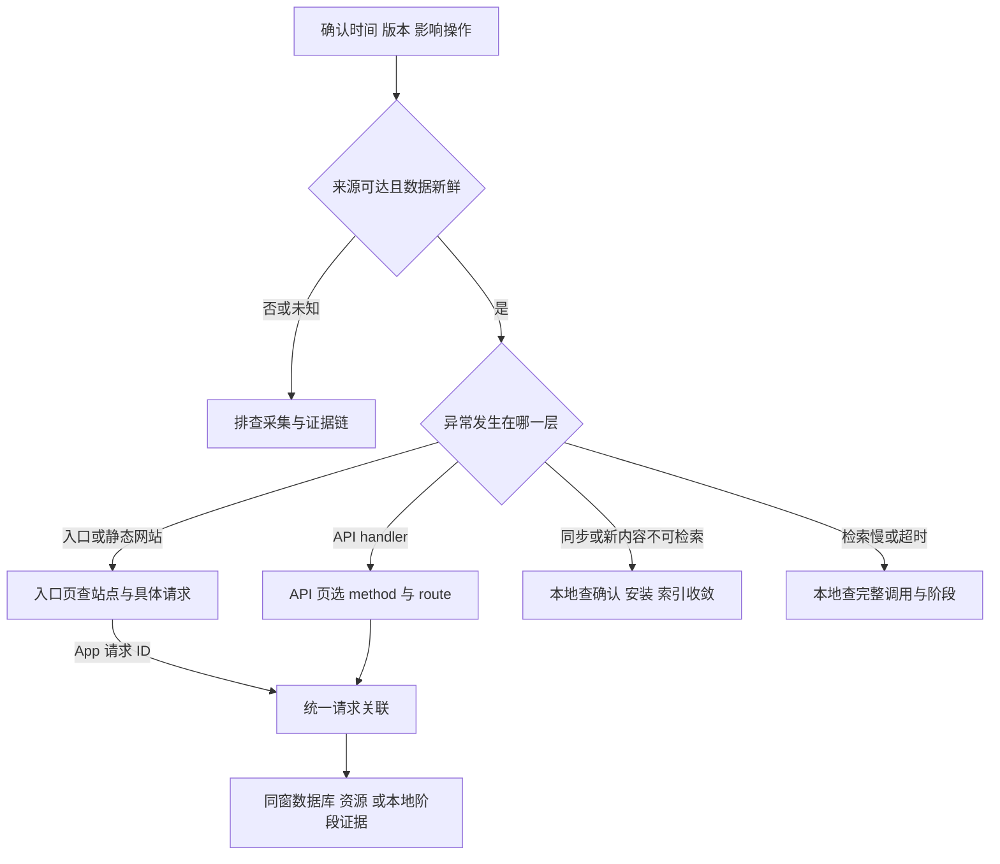

# Clumsies 可观测性运维排障指南

面向处理 Clumsies 性能异常、同步或检索故障的开发与运维工程师。先确认观测可信度，再按同一时间窗的吞吐量、延迟、错误和等待缩小范围，最后用具体请求或任务验证原因。指标口径和告警阈值以[可观测性设计方案](/zh/performance/observability-plan)为准。

## 开始前

需要安装的 Grafana 读取权限；查看主机服务日志需要相应 SSH 和系统权限。本地客户端问题需要该客户端的诊断访问权限，中心看板不会汇总所有客户端状态。

通过监控隧道打开 Grafana；端口绑定安装主机 loopback，不直接暴露公网：

```sh
ssh -N -L 3000:127.0.0.1:3000 -L 9090:127.0.0.1:9090 -L 9093:127.0.0.1:9093 <installation-host>
```

隧道建立后，将对应地址复制到浏览器。这些地址指向操作者本机转发端口。

| 页面 | 隧道地址 | 用途 |
| --- | --- | --- |
| 运行总览 | `http://localhost:3000/d/clumsies-overview-zh/view` | 影响、性能与可信度摘要 |
| 业务 API | `http://localhost:3000/d/clumsies-api-zh/view` | method/route 与请求关联 |
| 入口与网站访问 | `http://localhost:3000/d/clumsies-web-zh/view` | 站点入口及访问日志 |
| 基础设施与运行保障 | `http://localhost:3000/d/clumsies-infrastructure-zh/view` | 数据库、资源和证据链 |
| Prometheus Alerts | `http://localhost:9090/alerts` | 规则及 pending/firing |
| Alertmanager Alerts | `http://localhost:9093/#/alerts` | 通知分组与静默 |

记录故障发生的绝对时间、影响的操作/站点、客户端与 Server 版本、可获得的 request ID 或 operation ID。各页使用相同绝对时间范围。旧数据超过 14 天可能已无容器日志；版本和最后成功发布快照用于对照实际发布记录，不能代替完整历史。

## 选择排查路径



“没有告警”只表示当前规则未 firing。Watchdog 常驻属于通知心跳；收到邮件才验证到收件箱的投递。warning 和 critical 当前使用同一接收器，不代表不同响应通道。

## 阅读同一时间窗的图

1. 在总览查看数据可信度、目标状态、当前故障，以及业务请求/s、各类样本、5xx 和 handler 延迟。中心正常不能排除客户端问题。
2. 拆到对应站点或 method/route。请求组合改变可以使总 p95 改变，应先对比相同操作。
3. 查看进入、返回、取消与执行中请求。完成吞吐下降且并发/等待上升，是工作未结束的线索，不能单凭它认定具体瓶颈。
4. 查连接获取、数据库、CPU、内存与磁盘同窗证据，再选择一个请求或任务验证。资源与延迟同时上涨不是充分原因证明。
5. 修复后对相同操作和代表性负载复测，同时确认结果正确、错误与等待恢复、用户完成耗时改善。

| 信号组合 | 优先检验 | 继续查什么 |
| --- | --- | --- |
| 吞吐上升，延迟与错误稳定 | 本次负载被承受 | 持续观察；不能直接推算极限容量 |
| 完成吞吐趋平，并发/等待上升 | 依赖或执行容量开始受限 | 连接获取、事务、模型/worker 与资源 |
| 低流量错误比例很高 | 少量失败被比例放大 | 失败次数、操作价值及具体请求，不统一抑制写入失败 |
| 延迟下降，错误升高 | 快速失败减少了执行工作 | 成功与错误分布、错误码 |
| 入口慢，handler 快 | 代理、正文传输或样本不同 | 同一 request ID 的入口/上游/客户端记录，不能减两层 p95 |
| 无流量，延迟无样本 | 正常空闲或没有进入请求 | 抓取、探针和进入计数；无样本不是 0 ms 成功 |
| 快照不变且年龄增长 | 采集冻结 | timer、SQL 结果和真实 textfile 时间 |

`rate` 表示每秒速率，`increase` 是窗口外推量，可能有小数。分位数是桶内估计，结合相应分类的样本数；p99 对低样本尤其敏感。旧混合结果曲线不能读成成功请求延迟，旧全路由 in-flight 包含 health 与 metrics，不能读成业务积压。

本地 Health.performance 是进程累计统计。单份导出不能说明最近五分钟；对比同一 process_id 和 collection_started_at 的两份快照，使用计数与累计桶差值评估该区间，in_flight 看当前值。collection_elapsed_ms 提供单调区间长度；重启后重新采样，不将前后快照拼接。

## 评审创建或接口响应变慢

### 定位步骤

1. 从总览确认异常时间、业务完成吞吐、5xx 量与比例、成功 handler 延迟和样本。若是旧 schema，使用明确标注的混合结果，不能假设已隔离成功响应。
2. 到 API 页选择对应 route template 和 method。创建与合并分别选实际操作；无 method 样本时使用日志区分，不能用混合 GET/POST p95 评价单项操作。
3. 查看忙路由、慢请求和错误响应延迟，展开一条代表性请求，复制 request ID 或打开 Related request logs。
4. 在统一关联区对照入口与 Server。优先使用入口返回 ID，或本地 http_headers 中的 server_request_id；只拿到客户端 ID 时先匹配 Server client_request_id，再取该记录的内部 request_id 查看入口。该区忽略 site/route/method；空 ID、missing 占位不返回日志，前缀不是完整 ID。入口慢而 handler 快时，查看响应字节、上游计时和本地完整 HTTP 耗时。
5. 到基础设施页查看同窗 pool used/idle/open/max、数据库可达性与连接容量。review_create/review_merge 还有 acquire 耗时、结果和进行中次数，其它事务不能据此判断等待。

### 判断与恢复

连接 acquire 变慢只能说明获取过程变慢，可能涉及等待、验证和新建连接；继续检查连接持有、事务和锁证据，再决定是否调整容量。五分钟最长查询快照不能排除短时拥塞。不要仅凭高连接数扩大连接池。

若 Server 处理快但用户操作慢，回到同 ID 的入口和本地 HTTP/XPC 记录，检查传输、解码、客户端调度及重复串行请求。客户端超时或取消不证明写入未发生；重试前确认原操作结果，并使用既有幂等/版本机制。

### 完成条件

代表性操作能够明确主导阶段；相同负载下该阶段等待、错误和用户完整耗时恢复，吞吐恢复，操作结果及关联身份保持正确。

## 新修改没有同步或不可检索

### 定位步骤

1. 分清本地保存、Server 持久确认、本地 synced 提交、Commit/Ref 安装和当前索引可检索几个结果。中心 HTTP 2xx 与产品 Commit 数不能代替这些事件。
2. 打开本地 Runtime 诊断，按稳定 operation ID 查看 queued 起点、pending/failed/blocked、每次尝试和实际 Server 确认。oldest_pending_operation_at 覆盖可访问项目的 queued/syncing/retrying，oldest_failed_operation_at 覆盖 failed；两者都是原始入队时间，不是最近重试或失败时间。无需上传的本地操作不能计为写入确认。
3. 选择对应项目后，检查 commit_sync.last_checked_success_at 与实际 Ref 安装时间。无变化的可信检查也应推进 checked；最后安装时间旧可以是正常空闲。未选项目的全局状态和 Draft channel 此字段为 None，是接口范围，不应补造全局检查时间或判为故障。
4. 比较已观测的远端 Ref/cursor 和本地安装值。没有带时间的远端目标时，不能仅凭本地 cursor 推算真实落后量。
5. 检查索引目标和 active head、pending_since、published_at 及最近构建/发布结果。pending_since 跨重试和目标更新保持，当前目标收敛后清除；published_at 仅真实原子发布推进，后续新积压保留旧值。superseded 可以让位给新目标；发布后维护失败与索引不可用分别处理。升级前没有可信起点的历史工作仍显示年龄未知。

### 判断与恢复

同步周期返回 Ok 不证明所有 Draft 收敛，尝试成功也不等于唯一逻辑操作完成。先确认原操作在 Server 的实际结果，再按既有恢复机制继续，避免把客户端超时当未写入而重复提交。

权限阻塞和不可访问对象需要明确呈现，不能从健康视图中直接消失。不要用 Draft 创建年龄或未读存量决定重试、发布或清理人类工作。

### 完成条件

原操作有明确终态；目标 Ref 已装入，当前索引对齐有效目标且目标内容可检索，剩余工作及阻塞可解释。空闲项目不因旧安装时间误报，历史未知年龄仍保持未知。

本地过程统计不足以评估“99% 改动五分钟内到 Server”：合格事件契约、首次确认持久去重和到期未完成分母尚须齐备。

## 检索慢或超时

### 定位步骤

1. 在本地按 request ID 查询 retrieval_run_started，取得 run_id 后查看对应 Run。Health.performance 的 activate 观测覆盖参数验证、等待、查询和完整 history 收尾；再与客户端完整 XPC 响应耗时比较。中心 API 看板不会显示本地模型或检索等待。
2. 对照输入大小、语料规模、模型 cold/warm 状态，以及同期索引和 embedding 工作，保持比较条件一致。
3. 分开 search/storage/history 锁等待、model gate 等待、blocking 排队、实际模型执行与历史记录收尾。未提供的阶段标为未覆盖，未执行阶段不当作零耗时样本。
4. 对照已有 Run 字段的包含关系：effective_memory 与 index_ensure 可能重叠，embedding/rerank 旧边界包含等待，Run.total_us 在 history 完成前截止，不能作为完整 activate 耗时；检索既有 60 秒预算只包查询段，不代表完整调用必在 60 秒内返回。activate 过程统计仍不包含 XPC 传输与客户端解码。

### 判断与恢复

等待增加而执行稳定时检查争用与并发；执行变慢且等待稳定时检查模型、硬件和工作量。没有相应阶段记录时，用日志和本地资源工具形成线索，不从两个分位数相减补造阶段。

技术成功、空结果和命中质量分别判断。修复超时后仍用已有人工评测验证检索质量；空结果率不代替 Recall/nDCG。

### 完成条件

能区分等待、执行、记录收尾和技术失败；操作恢复，完整计时边界可验证，未执行/失败默认零未污染分位数。

## 图表为空或数据一直不变

### 定位步骤

1. 到基础设施页查看逐预期 target 的状态：1 正常、0 抓取失败、-1 缺失。若只显示“旧配置已发现目标”，先核对目标清单，不能据此排除误删。
2. 区分 exporter 可达与内部任务结果。例如 PostgreSQL exporter 抓取成功不等于 pg_up=1；node-exporter 可达不等于 SQL 快照成功。
3. 查看数据库和主机采集时间、success 与年龄。有效当前年龄必须在 0 至 900 秒；超过 15 分钟、负年龄或缺失均不可用于正常判断。-2 表示未来事件时间无效，-1 表示过期/缺失。查系统时钟、最近回拨和源时间；保留原始戳，不补零或改历史以消除告警。旧 textfile 被重新抓取不证明数据更新。
4. 日志为空时核对时间、14 天保留、source discovery、Alloy/Loki 状态、重试及丢弃。零发送可能为空闲，成功发送也不能证明每个来源已配置。
5. 备份/恢复分别查看最近任务状态、有效成功年龄、原始成功戳和主机采集年龄。failed 不应撤掉旧成功；never、missing、running 不可读作成功。未来成功/退出时间或无效主机采集不能读作正常；发布页也将原始时间与可信度分开，原戳保留不代表当前发布健康。
6. 通知异常查看 Alertmanager 抓取、失败计数、日志和静默；同一通道故障可能无法发出自身失败邮件。

在安装主机进行下列只读检查。`.env` 作为 Compose 参数读取，不把凭据内容复制到排障记录。

```sh
cd /opt/clumsies/observability
sudo systemctl status clumsies-observability-metrics.timer --no-pager
sudo systemctl show clumsies-observability-metrics.service -p Result -p ExecMainExitTimestamp
sudo journalctl -u clumsies-observability-metrics.service --since "30 minutes ago" --no-pager
sudo docker compose --file compose.observability.yml --env-file .env logs --since 30m --tail 200 alloy loki alertmanager
```

预期目标来源为 `prometheus/targets.json` 与 `prometheus/probes.json`，部署验证核对其与规则清单一致。找到来源故障后，按[部署指南](/zh/guides/deploy-for-an-org)及现有配置交付流程恢复相应组件，再观察新事件到达和真实采集时间推进。不要通过补零、删除历史或生产故障注入让图表看起来正常。

### 完成条件

每个来源的结果与真实观测时间清楚；缺失、冻结和失败均可见，恢复后新事件能从源头到看板或日志。告警按实际故障恢复，Watchdog 保持预期心跳。

## 故障处理记录

记录受影响操作、绝对时间范围、环境与版本、关联 ID、代表性样本、主导阶段、修复动作和复测结果。将观察与原因假设区分开；容量结论还应记录硬件、数据规模、请求组合和持续时间。引用请求或本地证据时保留其权限和脱敏边界。

指标定义、阈值和验收见[可观测性设计方案](/zh/performance/observability-plan)，跨层耗时关系见[端到端延迟模型与诊断](/zh/performance/latency-model)，本地数据归属见[本地运行时](/zh/runtime)。
