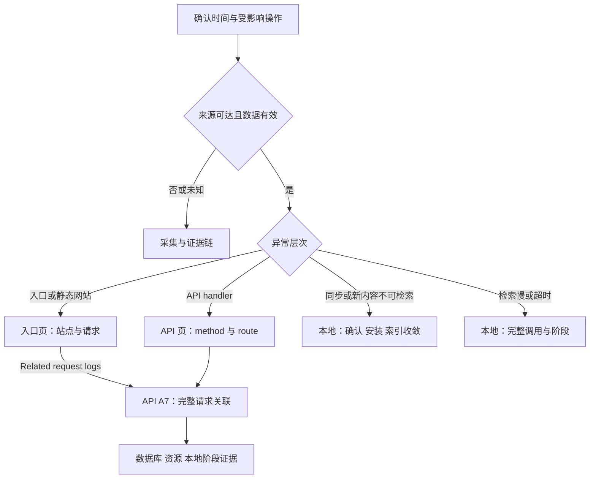

# Clumsies 可观测性运维排障指南

本指南面向处理 Clumsies 性能异常、同步和检索故障的开发与运维人员。处理顺序是确认数据可信度、比较同一时间窗的吞吐量、延迟、错误和等待，再用具体请求或任务验证原因。指标定义和告警阈值见[可观测性设计方案](/zh/performance/observability-plan)。

## 访问与现场信息

中心排障需要 Grafana 读取权限；主机服务日志需要相应 SSH 和系统权限。客户端故障使用该客户端的本地诊断。通过 SSH 隧道访问安装主机的监控服务：

```sh
ssh -N -L 3000:127.0.0.1:3000 -L 9090:127.0.0.1:9090 -L 9093:127.0.0.1:9093 <installation-host>
```

| 页面 | 隧道地址 | 工作用途 |
| --- | --- | --- |
| 运行总览 | `http://localhost:3000/d/clumsies-overview-zh/view` | 确认影响、性能和来源状态 |
| 业务 API | `http://localhost:3000/d/clumsies-api-zh/view` | 按 method/route 定位，关联完整请求 ID |
| 入口与网站访问 | `http://localhost:3000/d/clumsies-web-zh/view` | 按站点检查入口和访问日志 |
| 基础设施与运行保障 | `http://localhost:3000/d/clumsies-infrastructure-zh/view` | 数据库、资源、采集及恢复证据 |
| Prometheus Alerts | `http://localhost:9090/alerts` | 规则、pending/firing 和持续时间 |
| Alertmanager Alerts | `http://localhost:9093/#/alerts` | 通知分组和静默 |

先记录故障的绝对时间、受影响操作或站点、客户端和 Server 版本，以及可获得的 request ID 或 operation ID。所有页面使用同一绝对时间范围。总览的来源状态决定图表是否可用于判断；基础设施页保存实际 Server 版本与发布记录。

## 排查路径



### 读图顺序

1. 在总览确认来源状态、当前故障、业务请求/s、样本数、5xx 和成功 handler 延迟。
2. 进入相应站点或 method/route，比较同一操作。请求组合变化会影响聚合分位数。
3. 对照进入、返回、取消和执行中请求，判断工作是在完成、等待还是快速失败。
4. 查看同窗连接获取、数据库、CPU、内存和磁盘证据，再选代表性请求或任务检验原因。
5. 修复后以相同操作和代表性负载复测，确认结果正确、等待与错误恢复、用户完成耗时改善。

| 信号组合 | 优先检验 | 所需证据 |
| --- | --- | --- |
| 吞吐上升，延迟与错误稳定 | 当前负载的完成情况 | 持续趋势；容量评估另做负载测试 |
| 完成吞吐趋平，并发或等待上升 | 依赖或执行容量受限 | acquire、事务、模型/worker 和资源 |
| 低流量下错误比例很高 | 少量失败的实际影响 | 失败次数、操作价值和具体请求 |
| 延迟下降，错误上升 | 快速失败 | 成功与错误分布、响应码 |
| 入口慢，handler 快 | 代理、正文传输或样本差异 | 同一 ID 的入口、上游和客户端记录 |
| 无流量且延迟无样本 | 空闲或请求未进入 | 抓取、探针和进入计数 |
| 快照不变且年龄增长 | 采集冻结 | timer、SQL 结果和 textfile 实际采集时间 |

### 统计读法

`rate` 表示每秒速率；`increase` 是窗口外推量，可以有小数。HTTP 分位数是滚动五分钟的桶估计，按 method 和结果分类，并配合相同范围的样本数阅读。低样本 p99 波动较大；空闲窗口保留无延迟样本。

本地 `Health.performance` 为进程累计统计。区间分析需要两份相同 process_id 和 collection_started_at 的快照：对计数、总耗时和累计桶作差，以 collection_elapsed_ms 的差值计算速率；in_flight 读取当前值。进程重启或计数回退后重新建立区间。

## API 或评审操作变慢

### 定位

1. 总览确认业务完成吞吐、5xx 次数与比例、成功 handler 延迟和样本。
2. API 页选择实际 method 和 route template。查看忙路由、慢请求与错误响应分布。
3. 展开代表性日志并点击 **Related request logs**，携真实 ID 和时间进入 API A7。手工关联也在 API 页的 **Request ID** 输入完整 ID；网站页通过导航进入该关联区。
4. 使用入口返回的 ID 或本地 HTTP 记录中的 server_request_id 对照 Caddy 与 Server。仅有客户端 ID 时，先查 Server client_request_id，再用该记录的内部 request_id 查入口。关联区跨 site/route/method 查询。
5. 基础设施页检查同窗 pool used/idle/open/max、数据库可达性和连接容量。评审创建与合并还可查看各自 acquire 耗时、结果和进行中次数。
6. 入口较慢时，API 页的 App 入口链接进入网站 W5，检查原始路径、响应字节、上游计时；随后与本地完整 HTTP/XPC 耗时对照。

### 判断与恢复

Acquire 涵盖等待、验证和新建连接。结合连接持有、事务与锁证据决定恢复动作或容量调整。若 Server 处理快而用户操作慢，继续检查正文传输、解码、客户端调度和重复串行请求。

客户端超时或取消后，先确认原操作的 Server 结果，再使用既有幂等或版本机制重试。

### 验收

代表性操作的主导阶段已有证据；相同条件下等待、错误、吞吐和用户完整耗时恢复，业务结果与关联身份正确。

## 修改尚未同步或不可检索

### 定位

1. 分别确认本地保存、Server 持久 ACK、本地 synced 提交、Commit/Ref 安装和当前索引可检索状态。
2. 本地 Runtime 诊断按稳定 operation ID 查看入队、pending/failed/blocked、每次尝试及 Server 确认。oldest_pending_operation_at 覆盖可访问项目的 queued/syncing/retrying；oldest_failed_operation_at 覆盖 failed。两者都保留原始入队时间。
3. 选择项目，检查 commit_sync.last_checked_success_at 与 Ref 安装时间。可信的无变化检查也推进 checked；空闲项目的安装时间可以较旧。该检查字段为项目级，全局状态和 Draft channel 的 None 表示范围未提供。
4. 比较已观测远端 Ref/cursor 与本地安装值；记录远端目标的观测时间。
5. 检查索引 target、active head、pending_since、published_at 与最近构建/发布结果。pending_since 跨重试和目标变化保持，收敛后清除；published_at 在真实原子发布后推进，新积压保留先前发布时间。
6. 区分 superseded 让位于新目标、发布后维护失败、权限阻塞和实际索引不可用。

### 判断与恢复

按原逻辑操作核对实际结果与剩余工作。同步周期的 converged、partial、failed、skipped 与单次尝试结果分别解释。权限阻塞和不可访问对象需明确记录；历史工作缺少可信起点时保持年龄未知。

恢复按既有操作机制执行。人类 Draft 和未读存量用于理解工作状态，清理或发布仍遵循业务流程。

### 验收

原操作有明确终态；目标 Ref 已安装，当前索引对齐有效目标且目标内容可检索，剩余任务及阻塞均可解释。

## 检索慢或超时

### 定位

1. 本地按 request ID 查询 retrieval_run_started，取得 run_id 后检查对应 Run。用 Health.performance 的 activate 观察完整 daemon 调用，再与客户端完整 XPC 耗时对照。
2. 固定输入、语料规模、模型 cold/warm 状态，记录同期索引与 embedding 工作。
3. 分别检查 search/storage/history 锁等待、model gate 等待、blocking 排队、模型执行和后台 history 持久化。未执行或未覆盖阶段保持其实际状态。
4. 对照计时边界：effective_memory 与 index_ensure 可重叠；Run 的 embedding/rerank 含等待；Run.total_us 从校验后起点至查询结束。activate 包含参数验证、查询和 history 确认等待，截止于 daemon 返回。参数校验后建立的 60 秒截止时间由查询与常规确认等待共用。
5. 检查历史任务的实际终态。已接受的后台持久化在确认等待到期或调用者退出后仍可继续，Run 提交前可保持 running；用 history_lock_wait/history_persistence 和 Run 状态核对完成或持久化错误。初始 Run 创建、超时终态写入及故障记录有各自等待边界，完整调用以 activate 和客户端耗时分别观察。

### 判断与恢复

等待增加而执行稳定时检查争用与并发；执行变慢而等待稳定时检查模型、硬件和工作量。缺少阶段记录时，使用日志和本地资源工具补充证据。

技术成功、空结果和命中质量分别验收。超时恢复后，以既有人工评测验证质量，保留 Recall/nDCG 等质量指标的原定义。

### 验收

等待、执行、后台历史持久化与技术失败能够区分；调用返回正常，历史任务达到明确终态，计时边界清楚，未执行和失败样本保留正确分类。

## 图表为空、冻结或来源异常

### 定位

1. 基础设施页逐项检查预期 target。状态为正常、抓取失败或缺失；清单来自 `prometheus/targets.json` 和 `prometheus/probes.json`。
2. 区分 exporter 可达和内部任务结果，检查 pg_up、SQL success 及主机 timer。
3. 检查主机与数据库真实采集时间。当前有效年龄为 0–900 秒；状态 -2 表示未来戳无效，-1 表示过期或缺失。检查系统时钟、回拨及源时间，保留原始记录。
4. 日志检查时间范围、来源发现、Alloy/Loki、重试及丢弃。根据来源活动解释零发送。
5. 备份和恢复分别检查最近任务状态、最近成功年龄、原始成功时间及采集状态。success、failed、never、missing、running 分开显示；最新失败与历史成功可同时存在。发布页也将时间与可信度分开。
6. 通知检查 Alertmanager 抓取、失败计数、日志和静默。基础设施导航可直接打开 Prometheus 和 Alertmanager。

在安装主机执行只读检查：

```sh
cd /opt/clumsies/observability
sudo systemctl status clumsies-observability-metrics.timer --no-pager
sudo systemctl show clumsies-observability-metrics.service -p Result -p ExecMainExitTimestamp
sudo journalctl -u clumsies-observability-metrics.service --since "30 minutes ago" --no-pager
sudo docker compose --file compose.observability.yml --env-file .env logs --since 30m --tail 200 alloy loki alertmanager
```

凭据通过现有配置读取，故障记录仅保存脱敏证据。按[部署指南](/zh/guides/deploy-for-an-org)及配置交付流程恢复来源，再观察新事件和真实采集时间推进。有效的新成功可修复未来缓存；仍在未来的原始回执或归档需继续调查。保留原始回执和历史观察。

### 验收

每个来源的结果和真实观测时间明确；缺失、冻结和失败可见，恢复后新事件到达看板或日志，告警按故障状态恢复。

Watchdog 常驻为通知心跳，实际收件验证邮件投递。其他规则未 firing 表示尚未达到其触发条件。warning 和 critical 使用同一接收器。

## 判断边界与待完善项

| 证据 | 判断范围 |
| --- | --- |
| 中心看板 | 安装内入口、Server 和依赖；客户端等待使用本地诊断 |
| 跨层计时 | 同一事件对照；不同分位数及重叠阶段分别解释 |
| acquire | review_create/review_merge 的获取过程；其他事务另查证据 |
| SQL 快照 | 五分钟采样状态，短时连接或查询拥塞可落在采样间隔内 |
| 请求关联 | 完整 JSON ID 精确匹配；空值无日志，前缀不匹配，客户端 ID 可跨尝试 |
| 客户端同步 | HTTP 2xx、Commit 存量和尝试成功与持久完成分别核对；五分钟写入 SLI 的完整契约与持久分母尚待实现 |
| 本地性能 | 进程区间与 daemon 返回边界；XPC 传输、客户端解码、后台历史持久化单独观察 |
| 留存 | 日志 14 天、指标 90 天；历史异常的逐请求证据受日志留存限制 |
| 故障检测 | 同机监控和单一邮件通道；主机整体丢失与通道自身故障需要外部观察 |

## 故障记录

记录受影响操作、绝对时间范围、环境与版本、关联 ID、代表性样本、主导阶段证据、原因假设、修复及复测结果。容量结论另记录硬件、数据规模、请求组合和持续时间；引用本地或请求证据时保留权限与脱敏边界。

跨层耗时关系见[端到端延迟模型与诊断](/zh/performance/latency-model)，本地数据归属见[本地运行时](/zh/runtime)，可复现负载条件见[HTTP 本地负载测试报告](/zh/performance/observability-load-report)。

## 附录：历史数据与兼容

日常看板统一使用现行 method/status_class 和业务 in-flight。历史 route-only histogram 为混合结果，全路由 in-flight 包含 health/metrics；历史查询按原边界解释。升级后等待一个完整五分钟窗口再读分类分位数。

旧 daemon 缺少 performance 或持久积压起点时，诊断保持 unavailable 或年龄未知；客户端按兼容协议解码。
